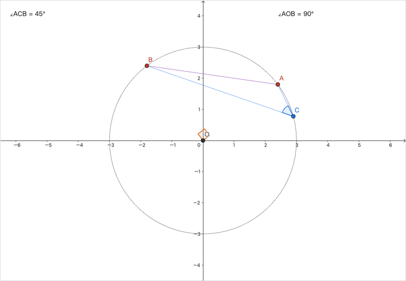

# DSH 社区分发与上架

本文用于把 `ggb-plugins-dsh` 发布到 npm、DSH 内置 Discover 和社区市场。
安装步骤只在 [DSH 安装说明](../dsh/README.md) 维护；本文只保留曝光与上架文案。



## 当前状态

| 项目 | 状态 |
| --- | --- |
| npm `0.8.5` | 已发布，latest；索引时间戳已同步 |
| DSH `0.2.1-rc.3` 安装 | 0.8.5 的 `engines.dsh` 为 `>=0.2.1-rc.2 <0.2.2` |
| 隔离安装验收 | TGZ 与 npm registry 安装、`setup-plugin`、GeoGebra 5.4.932.1 下载、doctor 均通过 |
| GitHub Release | [v0.8.5](https://github.com/Jack7510/ggb-plugins/releases/tag/v0.8.5) 已发布 |
| GitHub topic `dsh-plugin` | 已添加；同时添加 `deepseek-harness`、`geogebra` 等 |
| dsh-plugin.org 收录 | [Issue #436](https://github.com/dshplugin/dsh-plugin-hub/issues/436) 已提交 |
| 社区展示帖 | [Discussion #4](https://github.com/moyuqing-man/dsh-plugin-community/discussions/4) 已发布 |
| DSH Discover 索引 | [market/index.json](market/index.json) 已可分享 |

## 一句话介绍

中文：

> 把中英文二维数学题变成可交互、逐条件核验的 GeoGebra 文件。DSH 负责理解题意，
> 本地 CLI 负责执行、重载、检查和交付；不通过就不交付，也不替你给答案。

英文：

> Turn Chinese or English 2D math problems into verified, interactive GeoGebra
> files. DSH understands the problem; a local CLI executes, reloads, verifies and
> delivers the file. Failed checks block delivery, and it never answers the
> problem for you.

安装命令：

```sh
profile=desktop   # DSH 插件中心/Web 宿主改为 web
dsh plugin --profile "$profile" add ggb-plugins-dsh@0.8.5
node ~/.dsh/profiles/$profile/node_modules/ggb-plugins-dsh/scripts/setup-plugin.mjs
```

`setup-plugin` 会安装依赖、下载固定 GeoGebra runtime 并运行 doctor；一键安装只装
npm 包，不会自动完成这一步。

## 上架 dsh-plugin.org

1. 在 GitHub 仓库 **About → Topics** 添加 `dsh-plugin`；建议同时添加
   `deepseek-harness`、`geogebra`、`mathematics`、`education`。
2. 确认 README 首屏有上文的安装命令。
3. 到 <https://dsh-plugin.org/zh/submit> 提交。可直接使用下面的 Issue 文案。

标题：

```text
[插件提交] Jack7510/ggb-plugins — 把数学题变成可交互、可核验的 GeoGebra 文件
```

正文：

```markdown
### 仓库地址
https://github.com/Jack7510/ggb-plugins

### 一句话价值
把中英文二维数学题变成可交互、逐条件核验的 GeoGebra 文件；不通过核验就不交付，
也不提供题目答案。

### 能力分类
技能与智能体

### 安装命令
dsh plugin --profile web add ggb-plugins-dsh@0.8.5

### 兼容与运行要求
DSH >=0.2.1-rc.2 <0.2.2（已在 0.2.1-rc.3 验证安装）；Node.js 22+；pnpm 11；
Google Chrome 或 Microsoft Edge；固定 GeoGebra 5.4.932.1。安装后需运行
setup-plugin 下载 runtime 并执行 doctor。

### 许可证
MIT；GeoGebra runtime 另受 GeoGebra Non-Commercial License 约束，不随包再分发。

### 截图 / 演示
（附一张交付 GGB、verification.json 全通过、拖动验证的截图或 30 秒 GIF）

### 补充说明
DSH bundle 位于仓库 dsh/ 子目录，npm 包名为 ggb-plugins-dsh；仓库根 package.json
是开发工作区。若自动扫描只读取根 package.json，请按子目录收录，或告知需要独立
发布仓库。

### 提交前自查
- [x] 仓库已公开
- [x] 已添加 GitHub topic：dsh-plugin
- [x] README 包含安装命令
- [x] 插件导出 apply(ctx) 模块
- [x] 仓库根目录包含 package.json
```

收录后把徽章放进 README：

```markdown
[](https://dsh-plugin.org/plugins/jack7510/ggb-plugins-dsh)
```

## 让 DSH 内置 Discover 可发现

DSH 不自带统一索引，任何静态 `index.json` 都能作为插件源。本仓库的索引在
[market/index.json](market/index.json)，托管方式二选一：

- GitHub Pages：`Settings → Pages → Deploy from a branch → main /docs`，地址为
  `https://jack7510.github.io/ggb-plugins/market/index.json`；
- jsDelivr：`https://cdn.jsdelivr.net/gh/Jack7510/ggb-plugins@main/docs/market/index.json`。

在 DSH 中打开 **Plugins → More → Experimental plugins → Custom plugin markets**，
启用后在 **Discover → Add index source** 填入地址。0.8.5 的
`publishTimestamp` 已更新为 npm 发布时间；后续版本发布后同样更新：

```sh
npm view ggb-plugins-dsh time.<版本>
```

## 社区公告

GitHub Release [v0.8.5](https://github.com/Jack7510/ggb-plugins/releases/tag/v0.8.5)
已发布，附 Codex ZIP、DSH TGZ 和校验文件；发帖时可另配 30 秒演示 GIF。再到
[DSH 插件社区展示区](https://github.com/moyuqing-man/dsh-plugin-community/discussions/categories/plugin-showcase)
发作者自荐。发帖前读一遍
[官方社区规则](https://github.com/deepseek-ai/deepseek-harness/discussions/1797)。

可复制的展示文案：

```markdown
【插件自荐】ggb-construction：把数学题变成可拖动的 GeoGebra 文件

它做什么：输入一道中文或英文二维数学题，DSH 写原生 GeoGebra 程序，本地 CLI
负责执行、逐条件核验、导出、重载和交付。失败或无法核验的条件会阻止交付，
不会跳过；它不是答案生成器。

安装（DSH 0.2.1-rc.3）：
dsh plugin --profile web add ggb-plugins-dsh@0.8.5
node ~/.dsh/profiles/web/node_modules/ggb-plugins-dsh/scripts/setup-plugin.mjs

适合：几何、函数、方程、统计等二维题目；需要 Chrome 或 Edge。
限制：不支持三维、删除/重命名、一般数学证明。

仓库：https://github.com/Jack7510/ggb-plugins
```

## 发布检查清单

- [x] `0.8.5` 已发布到 npm，且 `npm view ggb-plugins-dsh engines.dsh` 显示范围
- [x] 用隔离 `DSH_HOME` 和 `web` profile 安装成功
- [x] `setup-plugin` 与 `doctor` 通过
- [x] `docs/market/index.json` 的时间戳已更新
- [x] GitHub Release `v0.8.5` 含两种包和校验文件
- [x] GitHub topics 包含 `dsh-plugin`
- [x] README 首屏有安装命令、截图和兼容范围
- [x] 演示 GIF 已制作并加入 README
- [x] dsh-plugin.org Issue 已提交（[#436](https://github.com/dshplugin/dsh-plugin-hub/issues/436)）
- [x] 社区展示帖已发布（[Discussion #4](https://github.com/moyuqing-man/dsh-plugin-community/discussions/4)）
