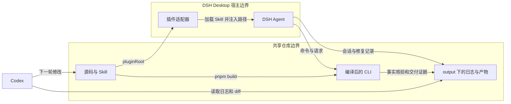
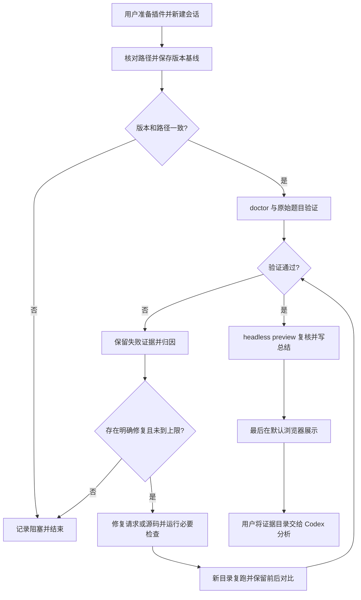

# DSH Desktop 验证、日志留存与源码修复

本文用于在 Codex 修改插件后，由 DSH Desktop 验证当前源码、保留证据并按失败原因修复。下方提示词可整段复制。默认允许 DSH 在保存修改前证据后修复当前仓库，不授权提交或发布。

本文是操作约定，不代表 Desktop 端到端验收已完成。已确认的实现依据是 [DSH 适配器](../dsh/index.js)、[插件配置注册](../dsh/cordis.patch.yml) 和 [Skill](../skills/ggb-construction/SKILL.md)。中文采用 STE 清晰写作原则，不声明 ASD-STE100 合规。

## 1. 准备当前版本

DSH 的工作目录与插件目录是两个独立配置。只打开当前仓库，不会更新 Desktop 已安装的插件。

| 模式 | 插件读取位置 | 更新动作 | 验收范围 |
| --- | --- | --- | --- |
| 源码开发 | 当前仓库 | 编译后重载插件，新建会话 | 当前源码与宿主协作 |
| 独立安装包 | Desktop 安装的 TGZ 副本 | 重新打包、安装并准备副本依赖，再重载 | 打包、安装及宿主协作 |

日常采用源码开发模式。在 Desktop 已注册的 GeoGebra 插件配置中，将 `pluginRoot` 设置为：

```json
{
  "pluginRoot": "<仓库绝对路径>"
}
```

`<仓库绝对路径>` 用 `git rev-parse --show-toplevel` 在仓库内取得，本文不写死本机路径。

这是适配器已支持的配置字段。Desktop 的具体配置入口随宿主版本而定，本文没有验收对应 UI 操作。不要把该 JSON 当作完整宿主配置文件。若同时配置旧字段 `skillRoot`，两字段必须指向同一目录。

首次准备及必要检查按 [AGENTS.md](../AGENTS.md) 执行。Codex 修改 TypeScript 后，在仓库运行 `pnpm check` 和 `pnpm build`。DSH 修复源码后也要重新编译。Skill、插件配置或实现变化后，重载插件并新建会话。不要用 `--from-default-profile` 初始化已有 Desktop profile；该参数会重置同名 profile。

最终独立包验收另行执行 `pnpm pack:dsh`，安装生成的 TGZ。副本依赖准备见 [DSH 安装说明](../dsh/README.md)。源码模式通过不能代替独立包安装验收。

## 2. 责任与执行流程



模型生成的请求仍须通过 CLI 核验。模型总结不能替代 `run.json` 或 `verification.json`。Codex 与 DSH 轮流修改源码；不要同时编辑同一工作区文件。



这里的状态属于人工验收流程，不是插件协议新增字段。

| 流程状态 | 进入条件 | DSH 动作 | 下一状态 |
| --- | --- | --- | --- |
| 待验证 | 新会话开始 | 保存基线、核对路径 | 验证中或阻塞 |
| 验证中 | 路径一致、环境可用 | 执行并记录检查 | 待修复或待展示 |
| 待修复 | 已保存失败证据 | 分类、修复、运行必要检查 | 验证中或阻塞 |
| 待展示 | 必要检查与交付复核通过 | 先完成日志，再打开默认浏览器 | 完成或展示失败 |
| 完成／阻塞／展示失败 | 达到对应终止条件 | 保留证据并报告实际范围 | 结束；再测使用新目录 |

## 3. 可直接复制给 DSH 的完整提示词

复制下面整段，把两处 `<仓库绝对路径>` 换成实际路径（`git rev-parse --show-toplevel`），并将最后的题目占位内容替换为实际题目。可一次提供多个带编号题目；每题独立留存。若只想验证，把“修复权限：允许”改为“修复权限：不允许”。

```text
请在 DSH Desktop 中验证并按需修复 GeoGebra 插件。

【工作目录与权限】
工作目录：<仓库绝对路径>
预期 pluginRoot：<仓库绝对路径>
修复权限：允许。
先读 AGENTS.md。保留已有未提交改动，不覆盖、不还原他人修改。
不得 git commit、发布、修改凭据或个人配置。
本轮由你编辑；不要假设 Codex 会同时替你修改。

【路径与版本检查】
使用已注册的 ggb-construction Skill。
核对加载的 Skill 内容与当前仓库是否一致，并检查注入的 CLI 路径。
pluginRoot 与 CLI 必须指向预期仓库。
无法证明实际路径，或仍指向旧安装副本时，保存诊断并停止。
不要从 Codex 缓存或其他 checkout 借用依赖、runtime 或 CLI。
不要自行重置 Desktop profile 或更改插件注册配置。

【证据目录】
先创建唯一目录：output/dsh-desktop/<时间戳>-<案例批次名>/。
下文称为本次目录。不得复用或覆盖已有测试目录。
在本次目录保存：
- session.md：原始题目、时间及时区、实际插件与 CLI 路径、
  git HEAD、git status --short、Node/pnpm 版本和验证范围。
- baseline.patch：本轮修改前的 git diff HEAD。
  该补丁不包含未跟踪文件；另外记录未跟踪文件列表。
  如需修改已有未跟踪文件，先在本次目录备份其原始内容。
- commands.md：命令编号、工作目录、完整命令、开始/结束时间、
  退出码、耗时和对应日志路径。
- logs/：每次命令分别保存原始 stdout 与 stderr。
- attempts.md：按时间记录请求错误、失败、诊断、修复和复跑结果。
- changes.md：本轮修改文件、原因、必要检查、前后对比与未验收项。
- summary.md：最终状态、耗时、首次通过情况、修复次数和证据索引。

原始命令日志不能用你的总结替代。
用工具实际观察退出码；不要因 tee 或其他管道得到错误退出码。
结构预检失败可能没有 run.json，仍须保存原始请求和命令日志。
只记录工具实际提供的 token 用量；不可获得时写“不可获得”。
不要复制凭据或整份个人配置到日志中。

【修改前验证】
按 Skill 执行 doctor，保留输出；同一副本未变化时复用本会话结果。
源码尚未编译或 dist 与源码不一致时，先按 AGENTS.md 编译。
记录准备与编译耗时，将其与题目运行耗时分开。
环境准备失败时先分类，不重复安装已正常的 runtime。

每题先独立生成请求，不读取 benchmark 答案键、既有成功请求或交付。
保留原始题意、来源、假设、必需条件和独立数学检查。
按 Skill 只分析和作图，不在回复、文字对象或截图中给出待求答案。
不得放宽容差、删除条件或忽略未定义对象来消除失败。
交互样本按题目与能力契约设置，保留参数往返及真实鼠标拖动证据。

每次请求修订保存为新文件，不能覆盖上一版。
每次 build 的请求 outputDir 都设在本次目录内的独立子目录。
先 check，再 build；每题本会话总共最多三次 build，修复后不重置计数。
check 只证明结构合法，不能代替原生命令、数学或交付核验。
保存全部 request.json、run.json、失败截图和成功交付。
不要只保留最终成功的一次。

【失败归因与修复】
先读首个错误及保存的证据，再决定修改位置：
1. 请求错误：修正本题原生程序、输出声明或检查写法。
2. 实现错误：在保存修改前证据后，修改当前仓库的必要实现和测试。
3. 环境问题：说明缺失依赖或版本，不把安装问题算作数学错误。
4. 测试脚本问题：修正记录或调用方法，不绕过生产核验。

修复权限为“不允许”时，到失败归因为止，记录并结束。
修复权限为“允许”时，可以按明确证据实施最小必要修复。
保持高内聚、低耦合和奥卡姆剃刀原则。
不添加题型路由、关键词模板、逐数学命令包装或生产故障开关。
不进行无关重构，不因失败扩展到发布或全仓风格改造。
同一个确定性错误不得原样重试。

源码修改后重新编译，按 AGENTS.md 运行受影响的必要检查。
数学执行、核验或交付改动必须运行真实 headless 浏览器回归。
修改 Skill、适配器或配置后若需重载才能生效，保存检查点并停止，
说明用户应重载插件并开启新会话；不能假称当前会话已使用新版。
复跑写到新的子目录，保留修改前后的所有证据。
相同代码状态下已通过的检查不重复执行。

【结束与展示】
所有自动检查和中间预览均 headless，保留截图。
成功交付后执行：
node <实际 CLI 绝对路径> preview --delivery <交付绝对目录> --headless --once
保存输出与退出码，确认复核完成且资源已释放。
如未通过，保留交付并记录复核失败，不声称验收完成。

展示前先写完 changes.md、summary.md 和所有日志。
summary.md 区分以下内容：
- 初次 check 是否通过、初次 build 是否交付。
- check 失败次数、build 尝试数、失败后修复次数。
- 首次成功后的额外构建次数；不要把美化算作失败修复。
- 准备、宿主墙钟、各次命令及 run.json 内各阶段耗时。
  各阶段可能重叠，不把所有数值简单相加。
- 通过条件、有限采样范围、未验收项，以及是否涉及源码修改。
- token 原始来源；没有宿主数据时明确标记不可获得。

达到三次 build 上限、没有明确修复、必要检查失败或必须重载时结束。
不要继续扩大测试范围或追加无关美化。

全部必要检查与交付复核通过后，最后的工具动作必须是：
node <实际 CLI 绝对路径> preview --delivery <交付绝对目录>
多题选择最后一题的成功交付作最终展示，索引中列出其他交付。
使用系统默认浏览器，保留预览进程并等待就绪 JSON。
若宿主不能保留进程，或预览返回失败，在最终回复说明展示未完成。
不要操作用户已有浏览器会话。
最后仅报告实际完成状态、本次证据目录和交付路径。

【题目】
<在这里粘贴题目；多题请编号>
```

## 4. 日志契约与交回分析

`session.md` 等文件是本流程要求 DSH 写入的记录，不是插件自动生成的宿主日志。插件自动生成文件的准确字段以 [能力契约](../skills/ggb-construction/references/capabilities.md) 为准。

| 记录 | 提供方 | 消费方与用途 |
| --- | --- | --- |
| 会话、命令、修复记录 | DSH Agent 与命令工具 | Codex 分析编写请求、失败修复与整体耗时 |
| run.json | CLI；进入运行目录创建阶段后产生 | 定位执行阶段、时长、失败与交付状态 |
| verification.json、截图与 GGB | CLI 交付管线 | 核对实际事实、交互和交付结果 |
| 原始宿主会话导出 | Desktop 会话库 | 核对模型事件与 token；路径与字段见下 |

Desktop 把每个助手消息的用量写入会话库：`$DSH_HOME/sessions/<工作区>/<会话 ID>/session.v4.jsonl.zstd`（zstd 压缩的 JSONL）。逐行 JSON 中 `type` 为 `assistant/message` 的记录带 `time`（毫秒）与 `usage.{inputTokens,outputTokens,cacheReadTokens,cacheWriteTokens,totalTokens}`；可按 `time` 截取某一批次窗口求和。`$DSH_HOME` 默认 `~/.dsh`，会话 ID 与目录名可从当前会话的 `DSH_SESSION_ID` 取得。这条路径已在本机用 10 题批量验证过（24 个回合、9.62 M token，其中缓存读取占 99.4%）。

文件日志不能证明模型内部推理耗时。命令间隔也不能全部算作模型时间。会话库缺失或不含 usage 时，不估算为实际 token 消耗。已验证的 DSH CLI `--json` 采集属于另一种宿主运行方式，不能冒充 Desktop 日志。

结束后，在 Codex 中发送：

```text
分析 output/dsh-desktop/<本次目录>/。
结合日志、失败证据和当前 diff，分析耗时、失败原因及优先修复项。
区分 DSH 修改前已有差异与本轮修改，不把未验收项写成已通过。
```

本流程覆盖组件责任、操作分支、验收状态和日志契约。Mermaid 图保留可编辑源；本文仅做静态核对，未验证 Desktop UI 或实际执行这段提示词。
