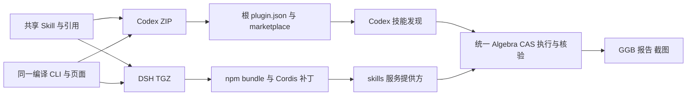
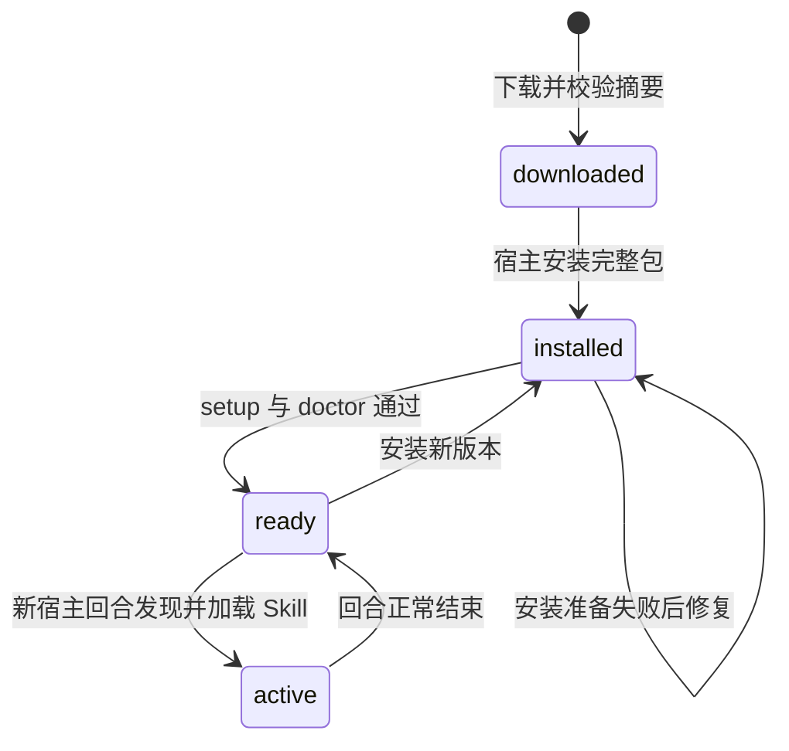

# Codex 与 DeepSeek Harness 兼容设计

版本：0.8.0。目标是分别满足两个宿主的插件契约、独立安装和技能发现要求，复用同一数学执行核心。此次不改变请求协议 2、M6 交付格式或固定 GeoGebra runtime。

## 架构与边界



两个包包含相同的八个编译模块、页面、安装器、锁文件和 Skill 资源。源码只维护一份 Skill；打包时分别复制。数学条件、原生命令及 GGB 提交仍由同一管线处理，不按宿主或题型增加数学分支。两种包各有自己的依赖和 runtime，不读取另一种生态的缓存。

| 项目 | Codex | DeepSeek Harness |
| --- | --- | --- |
| 分发 | `ggb-plugins-0.8.0.zip` | `ggb-plugins-dsh-0.8.0.tgz` |
| 插件清单 | 根 `plugin.json`，Agent Plugins schema | npm `package.json` 的 `dsh.bundle.patch` |
| 安装入口 | marketplace add、plugin add | `dsh plugin --profile ggb-plugins add <tgz>` |
| 发现 | `skills/ggb-construction/SKILL.md`，允许隐式调用 | Cordis 插件注入 `skills`，注册模型及用户可调用候选技能 |
| 引用与 CLI | 从 Skill 目录定位本包 | resourceBase 指向本包 Skill；正文追加本包 CLI 路径 |
| 升级 | 注册目标版本并安装、准备依赖 | 同一 profile 安装新 TGZ、准备依赖、重新启动 |

DSH 提供方仅注册技能及定位资源，不实现工具执行器。默认只定位本模块或源码父目录。显式 pluginRoot、兼容字段 skillRoot 与环境覆盖必须是绝对路径；两个配置字段同时存在时必须指向同一包。找不到 CLI 时说明安装缺口，不向 Codex 缓存回退。调用使用 PATH 中 Node.js 22+，不假设 Electron 宿主的可执行文件是 Node。

## 安装与运行契约

两个发布包均排除源码、测试、node_modules、GeoGebra runtime、Chromium 和用户产物。ZIP 经明确文件清单打包；DSH TGZ 通过 npm pack 的 files 清单生成。两种包都不运行安装生命周期脚本，用户在实际安装副本执行 setup-plugin；它安装生产依赖、准备匹配浏览器、校验 GeoGebra 并运行 doctor。

TGZ 中的 `dependencies.lock` 与源码 pnpm-lock.yaml 内容相同。npm 自动排除原名称；安装器先还原锁文件，再用 `--ignore-workspace --frozen-lockfile` 安装本包依赖，避免使用上层 DSH profile 的 workspace。



安装成功不等于依赖就绪；注册表发现不等于模型已调用；模型选择 Skill 不等于数学题已交付。这些步骤分别保留证据。自动构造、重载及预览均 headless 并保存截图。只有所有检查通过，持续运行的调用方才可展示最终 Chrome 预览。一次性 headless 宿主不保证答复后保留子进程窗口。

首次创建 DSH 独立 profile 可以使用 `--from-default-profile headless`。该选项会重置目标 profile，升级时禁止重复使用。此次按用户选择安装到独立 `ggb-plugins` profile，不改动由桌面应用管理的 desktop profile。宿主模型认证沿用现有账户，本插件不增加模型服务或密钥要求。

## 打包、验收与兼容范围

```sh
pnpm pack:plugin
pnpm pack:dsh
```

两者复用 `scripts/package-plugin.mjs`，仅选择宿主封装，版本必须一致。Release 工作流发布两种包及各自 SHA-256。DSH 采用官方支持的预编译 TGZ 分发，不要求从 Git 安装后执行 prepare，也不自动批准安装脚本。

回归检查包内文件、引用可读性、编译模块一致性、独立目录加载、无跨客户端缓存依赖及已有安装分支。真实宿主分别核对发现、加载及文字题交付；doctor、build、headless preview 继续由真实 applet 验证。详细环境与结果见 [双生态验收](dual-ecosystem-validation.md)。

本地安装、GitHub Release 与官方市场上架是不同事实。此次验证限于本机 Codex CLI 和 DSH 0.2.0-rc.2 的独立 headless profile；不宣称 DSH desktop、所有客户端版本、全部二维命令或公共市场审核已经通过。

规范依据：[OpenAI 插件打包](https://developers.openai.com/plugins/build/plugins)、[DSH bundle 与 profile 安装](https://deepseek-harness.github.io/deepseek-harness/en/develop/basic/publish)。本文采用 STE 清晰写作原则；不声明 ASD-STE100 合规。图源已静态核对，未单独执行 Mermaid 渲染。
