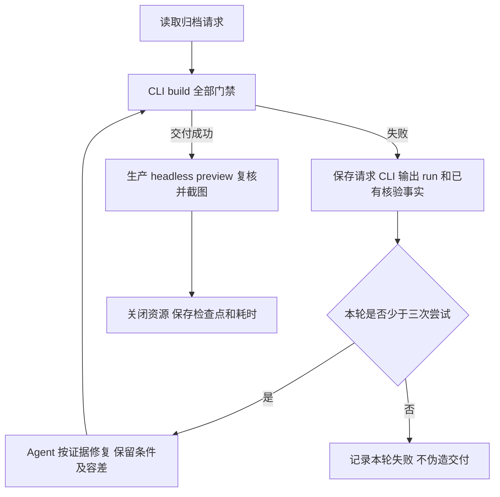

# 常见二维几何运行对比

日期：2026-10-16。生产代码：`5e167d9`，插件版本：0.8.0。本次只新增基准输入、运行脚本和报告，未修改生产执行器或门禁。

10 题各完成 3 次正式逻辑运行，主样本共调用 build 39 次，产生 30 份通过主样本门禁的交付。6 题在首轮需要修复，共增加 9 次尝试。额外的正多边形 12→3 往返检查失败，因此不能将主样本的 30/30 解读为全部题意和交互状态已覆盖。

逐次阶段数据、输入摘要和交付文件摘要见 [结果数据](geometry-benchmark-results.json)。原始文件保存在 [本机证据目录](../output/geometry-benchmark-20261016/)。output 按仓库规则不进入 Git；复制或清理工作区前应保存该目录。

后续代码与案例已更新；历史计时对应的不可变输入以证据 ZIP 的 final-inputs 和记录摘要为准，不能用当前 examples 代替历史版本。修复与新的宿主验收见 [DSH 主验证记录](../dsh/docs/dsh-primary-validation.md)。

## 1 方法与统计口径

使用当前仓库编译得到的 `dist/src/cli.js`，不借用客户端缓存或另一份 checkout。环境为 macOS arm64、Node.js v26.5.1、Chromium 156.0.8078.4、GeoGebra 5.4.932.1。固定 runtime 摘要保存在结果数据的 environment 中。

完整 doctor 在本会话执行一次，smoke 和 casSmoke 均通过。首次普通权限调用因回环监听被阻止；获准在所需权限下运行后通过。这是环境准备事件，不算数学题失败。原输出摘录见 [doctor 记录](../output/geometry-benchmark-20261016/doctor-observation.json)。doctor 未单独精确计时。

按题号串行运行，每题连续执行三轮。每次 build 都启动新的浏览器会话。原构造、重载及三个样本各有独立 applet；采样副本从原文件加载，不承接上一样本。九题使用真实鼠标拖动，08 题使用 n=4、6、12 的原生参数设置。每次交付再执行生产 openPreview 的 headless 复核，保存复核截图并关闭资源。

首轮失败时，Agent 读取证据并修正请求；同一逻辑运行最多尝试三次。成功后，第二、三轮沿用修正后的同一输入，仅改变 outputDir。已发现的通用编写问题也用于尚未运行的题目。它们不是三十次独立模型生成实验。

| 指标 | 本次定义 | 结果 |
| --- | --- | ---: |
| 首轮编写通过率 | 每题第一轮的第一次尝试成功数／10 | 4/10，40% |
| 逻辑运行首次通过率 | 30 轮中无重试成功数／30；包括复用已修正请求 | 24/30，80% |
| 修正后重复运行通过率 | 各题第二、三轮成功数／20 | 20/20，100% |
| 主样本最终交付率 | 构造、重载、三个样本及预览复核通过数／30 | 30/30，100% |
| 修复次数 | 39 次 build 减去 30 次逻辑运行 | 9 |

不能把 80% 或 100% 作为新题的 Agent 首次成功率。三个重复样本也不足以估计稳定的分位数或全平台收益。



图源已静态核对，未执行 Mermaid 渲染。构造状态机和提交不变量沿用 [设计第 5—7 节](ggb-plugins-design.md#5-流程与画布生命周期)，本文不另建状态协议。

## 2 各题结果

下面的三次耗时均为最终成功尝试的 CLI 墙钟时间，单位 ms，包含进程启动与请求读取。失败成本另列。首次通过列以三轮逻辑运行为分母。预览列从调用 openPreview 到复核就绪；不含额外截图、关闭资源或系统浏览器启动。

| 题目／可复现输入 | 第一次 | 第二次 | 第三次 | CLI 中位数 | 预览就绪中位数 | 首次通过 | 修复次数 |
| --- | ---: | ---: | ---: | ---: | ---: | ---: | ---: |
| [01 外接圆与外心](../examples/geometry-benchmark/01-circumcircle.json) | 3005 | 2888 | 2865 | 2888 | 505 | 2/3 | 2 |
| [02 内切圆与内心](../examples/geometry-benchmark/02-incircle.json) | 2879 | 2942 | 2872 | 2879 | 518 | 3/3 | 0 |
| [03 中线与重心](../examples/geometry-benchmark/03-centroid.json) | 2956 | 2880 | 2917 | 2917 | 547 | 2/3 | 1 |
| [04 欧拉线](../examples/geometry-benchmark/04-euler-line.json) | 3055 | 2970 | 2877 | 2970 | 532 | 3/3 | 0 |
| [05 圆心角与圆周角](../examples/geometry-benchmark/05-inscribed-angle.json) | 2919 | 2901 | 2952 | 2919 | 555 | 2/3 | 1 |
| [06 圆外点两切线](../examples/geometry-benchmark/06-tangents.json) | 2855 | 2900 | 2886 | 2886 | 514 | 3/3 | 0 |
| [07 相交弦定理](../examples/geometry-benchmark/07-intersecting-chords.json) | 2840 | 2894 | 2843 | 2843 | 509 | 3/3 | 0 |
| [08 滑块内接正多边形](../examples/geometry-benchmark/08-regular-polygon.json) | 2636 | 2559 | 2566 | 2566 | 543 | 2/3 | 2 |
| [09 将军饮马最短路径](../examples/geometry-benchmark/09-shortest-path.json) | 2970 | 2867 | 2899 | 2899 | 531 | 2/3 | 1 |
| [10 弦中点轨迹](../examples/geometry-benchmark/10-midpoint-locus.json) | 3025 | 2951 | 2913 | 2951 | 547 | 2/3 | 2 |

主样本成功 CLI 累计 86.483 秒；失败尝试累计 37.971 秒；headless 预览复核、额外截图和资源关闭累计 17.621 秒。三项合计约 142.075 秒。这不是本次 Agent 工作的总历时，不包含编写、诊断、工具往返、审批、doctor 和补充实验。

本次没有可用的模型 token 级计时或首份请求编写计时，故没有编造“模型推理耗时”。每次尝试的 startedAt、cliMs 和预览耗时均已归档；失败到重试的墙钟间隔包含分析、工具调度和其他工作，不能当作纯模型耗时。

## 3 各环节耗时

以下为成功运行的阶段中位数，单位 ms。三次样本的同名阶段先在单次运行内求和，再取中位数。Applet 列包含构造、重载和三个样本的五次初始化。它们会与采样和截图重叠，不能将这些列相加当作总耗时。

| 题号 | browser 启动 | applet 累计 | 程序执行 | 三阶段观察累计¹ | 导出 | 文件加载累计 | 拖动／参数累计 | 截图 | 清理 |
| --- | ---: | ---: | ---: | ---: | ---: | ---: | ---: | ---: | ---: |
| 01 | 98 | 1848 | 43 | 72 | 5 | 235 | 990 | 35 | 21 |
| 02 | 91 | 1861 | 40 | 90 | 5 | 232 | 993 | 34 | 21 |
| 03 | 98 | 1809 | 50 | 106 | 5 | 240 | 994 | 38 | 22 |
| 04 | 85 | 1922 | 46 | 92 | 5 | 247 | 983 | 30 | 27 |
| 05 | 97 | 1846 | 44 | 84 | 5 | 270 | 991 | 35 | 22 |
| 06 | 96 | 1833 | 44 | 90 | 5 | 245 | 999 | 34 | 18 |
| 07 | 96 | 1816 | 40 | 76 | 5 | 244 | 996 | 30 | 20 |
| 08 | 101 | 1856 | 46 | 130 | 5 | 287 | 10 | 26 | 23 |
| 09 | 96 | 1827 | 45 | 105 | 5 | 264 | 978 | 24 | 22 |
| 10 | 103 | 1903 | 40 | 69 | 6 | 276 | 1000 | 25 | 20 |

¹ 三阶段指构造观察、重载观察和样本观察；样本观察本身包含三个副本。累计项先在每次运行内合并对应阶段，再取三次中位数。逐次原始值以结果 JSON 的 timings 为准。

build 内部 totalMs 的中位数为 2387–2794 ms。CLI 墙钟与 totalMs 的差值中位数为 166–189 ms，包含进程启动、模块加载和未计入 build 的工作，不能全部归因于某一个 import。

五个 applet 的累计初始化约 1.80–1.92 秒，是最大的阶段累计量。九题的三个鼠标动作累计约 978–1000 ms；滑块三个设置累计约 10 ms。但滑块题 CLI 仅缩短到约 2.57 秒，因为页面初始化仍占主导，而且鼠标动作原先与下一页面初始化重叠。

实际程序执行仅 40–50 ms，导出约 5–6 ms，正式截图约 24–38 ms。五次观察的原生探针累计中位数为 14.45–43.08 ms，复杂值读取为 6.53–12.18 ms，快照采集为 23.88–54.07 ms。这批题未使用 CAS；不能用它们推断 CAS 优化收益。

## 4 失败与修复证据

每条失败保留当次不可变 request.json、cli.json 及已生成的 run.json／verification.json。输入检查在创建运行目录前拒绝时，没有 run.json，但仍保留请求与 CLI 输出。最初草案及中间版本保留在 attempt 目录，examples 保存最终可复现版本。

| 题号 | 首轮失败原因及顺序 | 保持条件的修复 | 失败 CLI 成本 |
| --- | --- | --- | ---: |
| 01 | Polygon 漏报附属边；嵌套 Text 依赖未决 | 声明全部输出；拆出文字表达式和位置对象 | 1459 ms |
| 03 | 距离比中的嵌套函数使文字依赖未决 | 将距离保存为原生对象，再生成比值 | 730 ms |
| 05 | angle 探针有实际值，但通用数值读取未接收该类型 | 用原生单位除法转换为数值，固定容差不变 | 756 ms |
| 08 | 附属边标签声明错误；文字依赖经过局部绑定列表未决 | 按真实标签声明输出；边长直接绑定相邻顶点，保留所有边和圆上的数值核验 | 1419 ms |
| 09 | 直线方程错误写成 l=y=0 | 改为原生命名方程 l: y=0 | 662 ms |
| 10 | 辅助半径点与路径点重合，目标拖动超时；随后漏同步条件来源 | 调整自行选择的辅助点位置；同步来源文本 | 32945 ms |

第 10 题首次失败耗时 32771 ms，其中最后一个 sample.drag 约 30339 ms。该次前两个拖动及数学核验已经通过。证据支持“重叠点处目标未移动”，不能据此声称已确认 GeoGebra 内部选中了哪个对象。第二次来源不一致由本次请求修复遗漏造成，不归因于数学引擎。

其他题在执行前也复用了已发现的通用编写修正；未产生 CLI 尝试的编辑不计入 9 次重试。因此首次通过率反映本次顺序工作流，存在经验迁移。

## 5 补充边界与未覆盖项

| 补充检查 | 结果 | 证据和边界 |
| --- | --- | --- |
| 欧拉线直角初态 C=(0,4) | 通过 | 新 build、独立重载、三个拖动、预览复核 |
| 欧拉线钝角初态 C=(-2,4) | 通过 | 新 build、独立重载、三个拖动、预览复核 |
| A、B 重合的弦中点轨迹 | 通过 | 新 build、独立重载、O/R 两个拖动、预览复核；没有声称能用鼠标区分重叠 A/B |
| 正多边形 3→12→3 连续变化 | 失败 | 12 边时通过；回到 3 边时留下 18 个隐藏且未定义的附属对象，objects_defined 拒绝 |

三个额外 build 的原始输入与交付见 [边界证据目录](../output/geometry-benchmark-20261016/edge-results/)，连续参数实验见 [polygon-return.json](../output/geometry-benchmark-20261016/polygon-return.json)。回到 3 边时，三条有效边和显示公式均正确，但仍有九个旧顶点及九条旧边未定义。保留了完整事实、12/3 边截图，并确认原正式 GGB 文件摘要未变。

正多边形主样本的三个参数测试都从 n=3 的原文件独立开始，所以没有覆盖增长后的收缩。主样本通过与往返失败同时成立。不能删除全对象已定义检查，或忽略所有隐藏对象来消除这个失败。该题交付只证明已记录的独立采样，不应宣称任意滑块往返均通过核验。

等边三角形欧拉线不唯一、圆周角跨弧分支、切线点进入圆内、三角形共线、任意次数往返和全部参数域未验收。有限采样不能证明这些范围。十份代表截图已合成 [总览](../output/geometry-benchmark-20261016/contact-sheet.png)，并完成目视检查；这是观察证据，不代替数学判定。

## 6 下一步优化方向

下面均为建议，尚未实现；按证据价值、用户等待和改动复杂度排序。

| 优先级 | 最小改进 | 责任位置 | 验收标准与取舍 |
| --- | --- | --- | --- |
| P0 | 补齐状态往返回归，先研究可避免残留附属对象的原生输入；保留当前全对象门禁 | 基准／浏览器测试、Skill 输入 | 3→12→3 时核验全部对象及边数；先使用开发测试表达序列，不为一个案例新增生产调度层 |
| P1 | 减少可避免的请求修复：记录 Polygon 真实多输出；说明直接依赖写法、方程命名和角度单位换算；提交前先 parseRequest＋compile | Skill、能力契约、宿主工作流 | 保留本次失败作反例；用新题重新测首次编写成功率，不能用已修正夹具自证 |
| P1 | 为无移动的真实拖动增加目标与重叠对象诊断，及早识别确定失败 | browser | 保留真实鼠标动作和位移门禁；复测重叠、路径约束、慢绘制和取消，不用 API setCoords 冒充鼠标拖动 |
| P2 | 分解 applet 初始化的资源请求、脚本解析和引擎初始化成本，再试小范围的固定资源复用 | browser／server 的诊断 | 逐个独立 applet、重新载入原文件和采样顺序不变；同时测内存、取消与污染，不先引入跨题常驻池 |
| P2 | 补全 angle 的通用数值事实采集，明确单位与有限值检查 | browser 采集、verify 数据判定 | 角度、数值、布尔、未定义与 NaN 反例全部保留；目标是减少修复，不是放宽容差 |
| P3 | 分解 CLI 固定开销；有证据后再评估命令级延迟加载 | cli | 以 166–189 ms 的端到端差值为研究上限，重测启动、信号和错误输出，避免为小收益增加常驻服务 |

本批数据不支持优先重写数学执行器、削减核验探针或压缩正式截图。探针成本只有几十毫秒，而一次确定性拖动失败就增加约三十秒。也不能用原生参数设置全面替代真实拖动：两者检验的行为不同。

新优化必须用同一请求和相同门禁交替测量修改前后版本；记录失败成本和峰值资源。当前报告只比较不同题目和三次重复，没有新实现或新的提速比例。此前版本对比继续见 [性能验收记录](performance-validation.md)。

## 7 证据、复现与限制

每次正式成功交付包含 result.ggb、request.json、verification.json、manifest.json 和 preview.png。数据文件的 evidence 数组列出 150 个文件的路径、大小和 SHA-256。完整原始证据另存为 [ZIP 包](../output/geometry-benchmark-20261016-evidence.zip) 和 [SHA-256](../output/geometry-benchmark-20261016-evidence.zip.sha256)，可整体复制保存。逐次 CLI 输出在各 attempt 的 cli.json，细分阶段在 run.json；另有 headless 预览复核截图。

30 份交付均重新检查构造、重载和三个样本状态；同题三轮的初始对象快照按生产 compareSnapshots 比较一致。初始核验结果数包含自动对象检查，分别为 49、51、70、56、51、57、54、44、61、38，不代表每题自然语言条件数。

先准备本仓库 runtime 和匹配浏览器，再运行：

```sh
pnpm build
node dist/src/cli.js doctor
node scripts/benchmark-geometry.mjs output/geometry-benchmark-new examples/geometry-benchmark 3
```

脚本串行调用真实 CLI，在失败后停止供 Agent 检查。修正对应请求后，以相同 output 参数重启可从检查点继续；已成功轮次不会重跑，未改输入的已知失败不会原样重试。每轮最多三次尝试。遇到预览失败，保留已成功构图交付和预览错误。

默认日期目录用于本次测量；新实验应使用新的 output 目录。examples 中是最终输入，新实验不能复现首次草案的失败率；要复查历史失败，应读取对应 attempt 的不可变请求。补充边界不混入 30 次主样本统计。

源码构建、脚本语法、全部最终输入的 schema／compile、交付状态／摘要、快照一致性、Markdown 本地链接及 diff 空白检查已验证。没有改动生产代码，因此没有为报告重复执行全仓故障套件。本文采用 STE 的中文清晰写作原则，不声明 ASD-STE100 合规。
