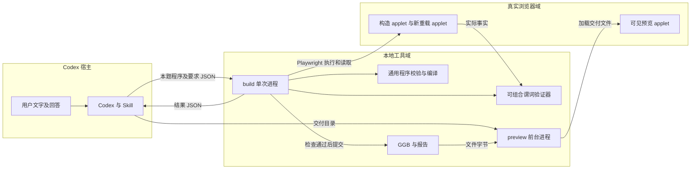
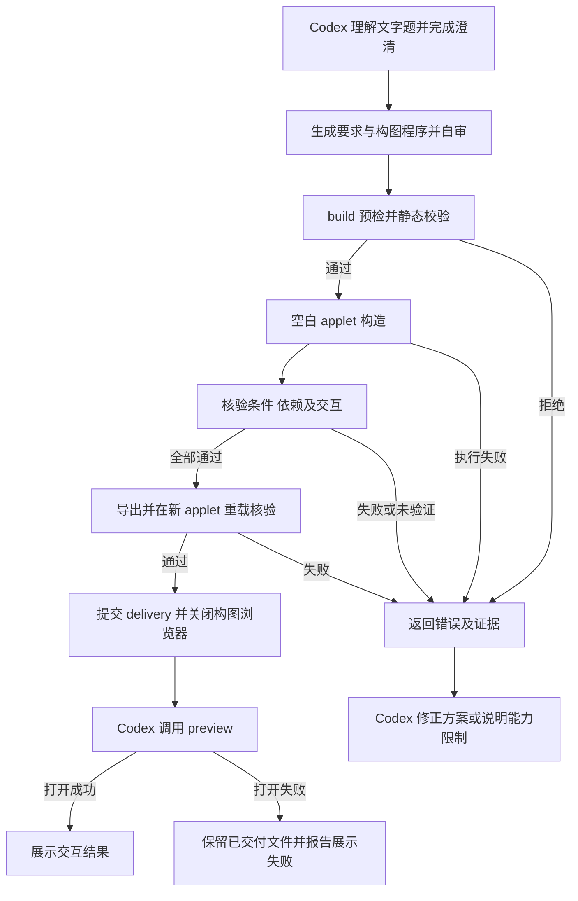
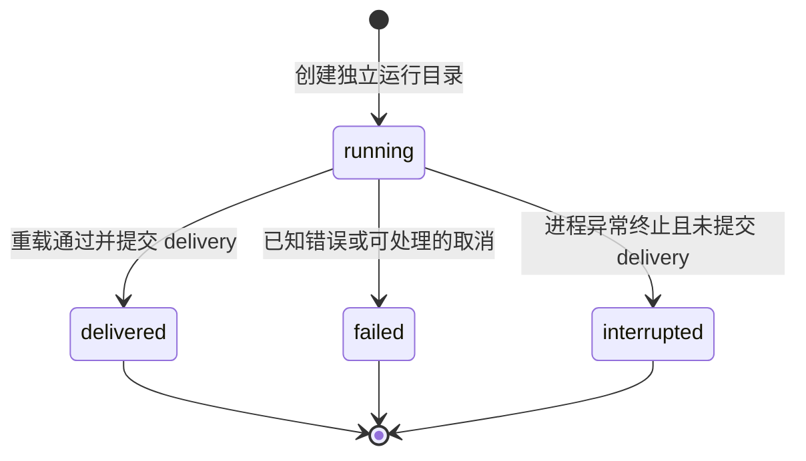

# ggb-plugins 独立工程设计草案

日期：2026-10-16。状态：M1–M4 已实现并在本地 Codex CLI 0.162.1 运行时验收；桌面 UI 自动化与其他平台不在已验证范围。

M2 已提供通用 `pnpm ggb build --request <file>`、`pnpm preview --delivery <dir>` 和仓库内 Skill。`pnpm demo` 通过同一接口运行三角形回归数据。运行方法见 [README](../README.md)，当前验证见 [M2 验收记录](m2-validation.md)，历史记录见 [M1 验证记录](m1-validation.md)。M3 已增加 `pnpm ggb doctor`；当前故障验收见 [M3 验收记录](m3-validation.md)。M4 的插件安装格式与目标客户端结果见 [M4 验收记录](m4-validation.md)，操作见 [安装说明](installation.md)。

`ggb-plugins` 是面向本地 Codex 的 GeoGebra 构图插件。第一版只处理文字二维题目。Codex 通过 Skill 理解题意并生成结构化方案。本地工具在真实 GeoGebra 中构造、核验、导出和重载，再打开可交互预览。

第一版优先完成一条端到端链路。工程采用一个 TypeScript 包、三个 CLI 命令和一个浏览器页面，不引入常驻构图服务、MCP、任务恢复系统或额外模型调用。原 `ggb_copilot` 工程仅作为参考和候选代码来源，不是运行依赖。

## 1 目标与范围

### 1.1 第一版产品要求

| 编号 | 要求 | 可观察的完成条件 |
| --- | --- | --- |
| R1 | Codex 承担题意理解和方案选择 | 不启动 DSH，不要求额外 Provider Key |
| R2 | 接受文字二维题目 | 保存题目及澄清回答；明确条件不被静默删除或改写 |
| R3 | 每次从空白画布新建 | 不读取外部 GGB 或活动浏览器画布作为基线 |
| R4 | 使用真实 GeoGebra 构造 | 返回实际对象事实，核对对象有效性和构造依赖 |
| R5 | 逐要求核验 | 必需要求全部覆盖；失败、未验证和缺项阻止正式交付 |
| R6 | 交付可重载 GGB | 从已核验画布导出；新 applet 加载同一文件后通过检查 |
| R7 | 展示可交互结果 | 可见浏览器加载交付文件；缩放及方案声明的自由点拖动可用 |
| R8 | 独立安装和运行 | 构建、安装和运行不读取原工程路径 |
| R9 | 新题通过生成程序解决 | 在已声明能力内换题、改名和改变构型时，复用相同执行与核验管线，不修改工具源码 |

### 1.2 能力边界

第一版先验收以下构造原语及对应检查。能力表限定操作和核验范围，不限定题型；不同题目通过组合这些原语解决。没有实现核验方法的操作不进入发布能力表。

| 类别 | 第一版能力 |
| --- | --- |
| 基本对象 | 自由点、线段、直线、圆、简单多边形 |
| 依赖构造 | 中点、两直线交点、过指定点的平行线和垂线 |
| 条件 | 点坐标、点在线上或圆上、圆心及半径、长度及长度相等、平行、垂直、非退化 |
| 呈现 | 标签、颜色、辅助对象可见性、线型、画布视野 |
| 交互 | 自由点拖动及依赖对象联动；浏览器缩放 |

首个样例为“作三角形 ABC，取 AB 的中点 M，连接 CM”。后续增加圆和其他已声明操作。圆与直线、两圆交点等需要分支选择的构造不在第一版范围内。

第一版不接受图片、外部 `.ggb`、已有画布续题、任意函数表达式、滑块、复杂轨迹、三维或通用数学证明。也不实现账户、云端服务、历史迁移、独立模型审查和自动故障恢复。超出能力的必需要求返回 `unsupported_operation` 或 `unverified`；不得删除条件后声称完成。

### 1.3 术语

“必须”表示验收约束。“应当”表示默认选择，偏离时记录理由。“可以”表示可选行为。

| 术语 | 含义 |
| --- | --- |
| 要求 `requirement` | 带原文来源和稳定 ID 的构图或呈现条件 |
| 方案 `plan` | 要求、可组合构图程序、样式和检查条件 |
| 构图程序 `program` | Codex 按本题生成的可组合操作序列，经统一接口执行 |
| 运行 `run` | 一次 `build` 调用及其独立目录；不跨调用恢复 |
| 构造依赖 | 对象由哪些输入对象及哪种操作生成 |
| 交付 | 通过构造核验和文件重载检查的 GGB、报告及截图 |

### 1.4 通用解原则

产品流程固定为：用户提出问题，Codex 生成构图程序，统一工具在真实 GeoGebra 中执行，返回事实和错误，Codex 按反馈修正程序，工具核验并交付文件。题目推理留在 Codex，工具维护可复用操作、事实读取和验收谓词。

- 不建立“中线题”“圆题”等题型路由，不用题干关键词选择固定脚本。
- 新题优先组合已有原语。只有缺少可复用底层能力时，才扩展工具并补充该能力的反例。
- 运行路径不得写死 A、B、C、M、固定坐标或唯一构图顺序。示例和回归用例可以使用固定数据。
- 核验器接收对象引用、关系、样式及交互范围。题目要求决定验收条件；生成程序不能自行降低条件或写入成功结论。
- 通用性通过同一套小接口表达多种构造实现。不提前建设通用解释器、题库、模板库或第二套几何计算引擎。

这一模式类比编程任务：Agent 根据问题生成程序，再通过执行结果迭代。这里的“构图程序”指通过统一接口表达的 GeoGebra 操作和依赖，第一版使用结构化数据，由 TypeScript 工具执行。该原则不新增脚本语言、解释器或运行时。

## 2 独立仓库与代码组织

GitHub 仓库为 [Jack7510/ggb-plugins](https://github.com/Jack7510/ggb-plugins)。Git 远程地址固定为 `https://github.com/Jack7510/ggb-plugins.git`，本地远程名称为 `origin`。

第一版采用一个 pnpm 工程。不拆 workspace 包，不为目录建立服务或插件框架。

```text
ggb-plugins/
  plugin.json                  本地执行插件清单
  .agents/plugins/marketplace.json  可安装的仓库 marketplace
  skills/ggb-construction/
    SKILL.md
    references/capabilities.md
  src/
    cli.ts                     doctor、build、preview 的进程入口
    doctor.ts                  依赖检查及真实 applet 冒烟
    schema.ts                  请求、方案及能力表
    compile.ts                 可组合程序校验及原生命令编译
    browser.ts                 applet 生命周期及事实读取
    verify.ts                  条件、依赖及交互检查
    delivery.ts                导出、重载和产物提交
  viewer/index.html            构图与预览共用的页面壳
  examples/                    题目请求及 M1 回归数据
  tests/
  docs/ggb-plugins-design.md
  THIRD_PARTY_NOTICES.md
  package.json
  pnpm-lock.yaml
```

只在文件职责过大时拆分模块。构建产物和启动脚本通过插件相对路径定位，不能依赖开发机器的绝对路径。M4 ZIP 采用显式文件清单，包含 dist/src 编译产物、Skill、页面、安装脚本、锁文件和许可；不包含源码、测试、runtime、依赖目录或用户产物。存在源码时，同一安装器始终安装构建依赖并重新编译；只有无源码的 ZIP 使用生产依赖分支。

M2 已删除生产路径中的 `triangle.ts`，将 M1 样例移至 `examples/triangle.json`。生产执行和验证接收程序及要求；不按新题新增 `solveXxx()` 文件。当前完整 JSON 契约见 [能力说明](../skills/ggb-construction/references/capabilities.md)，实现见 `src/schema.ts`。

选择性移植原工程代码前，核对来源提交、文件、依赖和许可证，并记录必要差异及测试。不得使用跨仓库相对路径、软链接或 `file:` 依赖。原设计所述 MIT 许可需在移植时核实并保留；它不覆盖 GeoGebra runtime 和官方手册。

## 3 插件形态与架构

Skill 负责题意理解、澄清、程序生成和结果说明。CLI 负责确定性执行及交付门禁，不识别或路由题型。第一版不建立手册检索子系统；Skill 使用精简能力说明，必要时查阅官方手册。

插件采用根目录 `plugin.json`，通过 `extensions.com.openai.requires_local_executor` 声明本地执行。仓库 marketplace 指向插件根目录。M4 已在 Codex CLI 0.162.1 验证安装缓存、命名空间 Skill 自动发现和资源相对路径；桌面 UI 的目录安装过程未自动化验收。参见[插件架构](https://developers.openai.com/plugins/concepts/plugins)和[插件打包](https://developers.openai.com/plugins/build/plugins)。



`build` 独占本次浏览器和输出目录。验证器消费实际 applet 事实，不接受模型提交的 `passed`。`preview` 只展示已交付文件，不修改验证结果。用户输入和模型方案均不可信；编译器只生成能力表允许的操作，不接受任意 JavaScript、GGBScript 或原始命令字符串。

## 4 输入、方案与 GGB 导入策略

### 4.1 build 请求

| 字段 | 类型 | 约束 |
| --- | --- | --- |
| `protocolVersion` | 必填，字面值 `1` | 不兼容其他协议版本 |
| `prompt` | 必填，非空 string | 用户题目原文 |
| `clarifications` | 可选，问答对象数组 | 保存影响题意的实际问答，缺省为空 |
| `locale` | 必填，string | 交付语言提示；M2 标签由 Caption 指定，诊断不自动翻译 |
| `plan` | 必填，结构化对象 | 要求、构图程序、样式及检查条件 |
| `outputDir` | 必填，string | 用户可写的产物父目录 |

schema 拒绝未知字段及用 `null` 代替缺失。M2 文本、对象数及文件大小限制见 schema；构图总时限为 120 秒。doctor 输出当前限制、容差、命令和谓词能力；自身总时限为 45 秒，单次浏览器及导出/加载等待上限为 30 秒。数值须为有限值；标识符和字符串按 schema 校验及转义，不拼接到 shell 命令。

Codex 在调用前完成必要澄清，不建立持久问答状态。请求中的每项要求包含 `id`、原文来源及 checks；检查记录对象引用和范围，结果以 `requirementId` 关联。自由点的示例坐标必须标记为方案选择，不能冒充题目给定条件。重试不得弱化要求；用户改变题意时使用新请求。

### 4.2 最小可组合构图程序

`plan.program` 表达本题的操作和依赖，不保存题型名称。对象创建、原生命令调用和样式设置采用统一结构。编译器检查名称唯一、引用存在、参数类型及依赖无环。命令能力使用数据描述名称、参数和适用对象，不为每道题或每个命令机械增加一层包装函数。

第一版只接受有限数值和对象引用，不引入通用表达式解释器。工具将结构化参数编译成已声明的 GeoGebra 原生命令，不直接执行模型提供的原始命令字符串、JavaScript 或 GGBScript。

```json
{
  "program": [
    { "id": "A", "op": "freePoint", "x": 0, "y": 0 },
    { "id": "B", "op": "freePoint", "x": 6, "y": 0 },
    { "id": "M", "op": "command", "name": "Midpoint", "args": [{ "ref": "A" }, { "ref": "B" }] }
  ]
}
```

以上仅示例 `plan.program`，不是完整请求。对象名称和坐标由题目与方案决定。程序可增加其他受支持命令并引用之前生成的对象，不触发题型分支。

检查条件使用独立的类型化谓词及对象引用，例如中点关系、两线垂直或对象可见。核验器读取真实事实后按谓词判定，不按题号选择 `verifyTriangle()` 等专用函数。工具核对要求覆盖和支持范围，但不能保证自然语言提取完整。Skill 自审时必须逐项对照题干。

相同几何条件可有多种有效构法。每种已支持操作声明可接受的构造依赖；验证器按其语义核验，不要求所有题目使用同一脚本。除非用户指定构法，不应把示例中的唯一命令序列当作数学要求。

### 4.3 GGB 导入策略

第一版拒绝用户提供的 `.ggb`、材料 URL、Base64 和活动画布输入，不提供续题入口。若用户请求续题，Skill 明确说明版本限制，不按对象名称重新创建后冒充原画布。

工具仅加载本次 `build` 刚导出的文件用于重载核验。`preview` 仅接受包含完整交付清单的目录，核对文件摘要后加载。清单用于一致性检查，不是对任意第三方文件的安全认证。第一版不将预览入口宣传为通用 GGB 查看器。

构造、重载和预览 applet 均禁用材料中的 JavaScript。运行资源从固定本地来源供应。具体参数必须在固定 runtime 上验证；不能把禁用 JavaScript 等同于禁用全部 GGBScript 或外部资源行为。参见[Applet 参数](https://geogebra.github.io/docs/reference/en/GeoGebra_App_Parameters/)。

外部 GGB 导入留待后续版本。实现前必须定义：文件及解压容量限制、脚本和自定义工具处理、外部资源限制、随机对象和动画策略、对象冲突、原文件不变以及输入摘要。不支持的内容应当拒绝；任何清理或转换都必须明确报告，不得静默改变文件语义。第一版不实现这套导入管线。

## 5 工作流程与有界修复



工具每次只执行一个候选方案，不在内部循环调用模型。Skill 默认最多调用 `build` 三次，每次使用新的 `runId` 和空白 applet，保留之前的错误。这个上限是工作流约束，不是宿主级安全隔离。

执行失败后不得接着修改半完成画布。崩溃或取消后不自动重放请求。再次尝试必须是新的独立运行。第一版不复用原九阶段游标、独立审查服务或动态重试策略。

## 6 画布生命周期与运行状态

### 6.1 画布生命周期

| 阶段 | 所有者与动作 | 结束条件 |
| --- | --- | --- |
| 构造 | `build` 启动本地资源服务和 Playwright 浏览器；等待空白 applet 就绪 | 受控命令执行完成或失败 |
| 核验 | 同一进程读取事实并检查；交互测试在独立副本中执行 | 检查完成；原构造画布保持不变 |
| 重载 | 同一进程新建 applet，加载导出的同一份字节 | 重载检查完成或失败 |
| 清理 | `build` 在退出时关闭所有候选 applet、浏览器和资源服务 | 不保留可续接的构图会话 |
| 展示 | `preview` 新进程启动本地服务和可见浏览器，加载交付文件 | 用户关闭浏览器或终止进程后释放服务 |

CLI 调用之间只传递文件和结果 JSON，不传递 Playwright 对象或浏览器连接。`preview` 必须等待 applet 加载交付文件并完成基本对象检查，才能输出一条就绪 JSON，再保持前台运行；Codex 使用宿主支持的进程会话保留它。一次性 codex exec 退出会回收前台进程；M4 用保持连接的 Codex app-server 验证答复后的预览存活，不引入插件后台服务。仅打开浏览器窗口不算就绪。用户关闭标签页后可能仍有浏览器进程，因此以关闭展示浏览器或终止进程为清理入口。

预览进程不提供控制 API、编辑 API 或后台守护功能。资源服务只监听 `127.0.0.1`，只映射页面壳和固定 runtime，检查 Host，不提供通用磁盘读取；CLI 读取 GGB 后通过 applet API 加载，不直接服务产物目录。预览修改不写回 `result.ggb`，也不继承原验证结论。

### 6.2 最小运行状态

运行清单由 `build` 单进程写入。构造、验证和导出是进程内步骤，不分别建立持久状态。



| 源状态 | 事件与守卫 | 动作 | 目标状态 |
| --- | --- | --- | --- |
| 无 | 成功创建独立目录 | 写入输入、方案及运行清单 | `running` |
| `running` | 全部检查及重载通过 | 原子提交交付目录 | `delivered` |
| `running` | 错误、超时或可处理取消，且尚未提交交付 | 保存错误，清理资源 | `failed` |
| `running` | 进程异常终止，且尚未提交交付 | 读取方识别为未完成；不恢复 | `interrupted` |

`interrupted` 是事后判定，崩溃进程不保证能写入该状态。进程仍存活时不能仅凭清单中的 `running` 判定中断。

正常退出及可捕获的取消必须清理资源。强制杀进程或系统崩溃不保证清理完成；第一版不自动连接残留浏览器，故障说明应当给出关闭残留进程的方法。

启动前注册取消监听，原生启动及上下文准备受启动阶段时限约束。取消后停止等待并清理已取得资源；迟到的原生启动结果由完成处理器关闭，不丢弃所有权。doctor 完成清理后重新检查取消和时限，再返回成功。交互核验与副本关闭同时失败时，保留核验错误，关闭错误附加为诊断；仅关闭失败时才将其作为主错误。

工具在原子重命名前关闭浏览器和资源服务；清理失败不得提交。`delivery/manifest.json` 是正式交付的提交标记，与其他交付文件一起原子提交。它存在且文件检查通过时，以交付事实为准，即使进程在更新外层运行清单前退出。不存在时，临时文件不构成交付。提交后外层 run.json 更新失败，build 返回交付路径及 warnings，不把交付改报为失败。失败处理保存原始错误，并附加清理或诊断写入失败信息。终态不恢复，工具不提供状态迁移接口。

每次调用使用新的运行目录，已有目录拒绝覆盖。不实现重复请求去重；明确重复调用会产生不同运行。预览打开失败不改变 `delivered`，但必须报告 R7 尚未满足。

## 7 本地工具契约

M3 已实现下表全部命令。`demo` 只是同一 build 接口的开发样例入口。请求从 JSON 文件读取；结果写到标准输出，诊断写到标准错误。

| 命令 | 输入 | 输出与副作用 |
| --- | --- | --- |
| `doctor` | 无 | 版本、依赖、限制及能力表；执行临时 applet 构造、导出和重载冒烟，结束后清理 |
| `build --request <file>` | 第 4 节请求 | 一次完成校验、构造、验证、导出和重载；返回产物路径或错误 |
| `preview --delivery <dir>` | 正式交付目录 | 核对清单及摘要，加载文件；输出就绪结果后保持前台运行 |

成功信封为 `{ protocolVersion: 1, ok: true, data }`，失败信封为 `{ protocolVersion: 1, ok: false, error: { code, message, details? } }`。M2 以独立运行目录标识一次构造；成功结果包含交付目录、GGB 文件和报告路径。`preview` 的就绪结果包含 URL；后续浏览器关闭属于进程生命周期事件。

错误至少区分：`invalid_input`、`unsupported_operation`、`runtime_unavailable`、`execution_failed`、`verification_failed`、`verification_unverified`、`export_failed`、`reload_failed`、`preview_failed`、`limit_exceeded`、`cancelled`。错误应当携带可定位的要求或步骤。退出码区分成功与失败；`preview` 就绪后的异常通过标准错误和退出码报告。

能力表同时声明构造参数、允许依赖、核验方法、容差和限制。schema 不接受模型指定容差或检查结果。协议变化同时更新 CLI、Skill 和测试；第一版不提供旧协议兼容层。

## 8 构造依赖核验与 GGB 交付

### 8.1 三类核验

Playwright 负责调用真实 applet 和采集证据；验证器负责判定。截图只能补充画面观察，不能代替数学关系或依赖证据。

| 类别 | 方法 | 结论范围 |
| --- | --- | --- |
| 当前状态 | 对象存在、类型、定义有效；读取坐标、长度和属性并计算受限关系 | 仅说明当前构型满足条件 |
| 构造依赖 | 读取真实对象的命令、定义或构造 XML，解析允许的操作与输入引用 | 说明对象使用已支持的依赖构造 |
| 交互行为 | 在副本中移动指定自由点，检查依赖对象更新及相关关系 | 仅说明已测样本通过，不证明全域命题 |

第一版使用固定 runtime 的有限命令解析器核对实际依赖，不以计划或编译日志代替真实画布证据。M2 优先读取构造 XML 的原生命令、输入引用及完整精度参数；自动生成的边可回退到非本地化命令文本。不建立通用 XML 规范化引擎。解析失败返回 `unverified`。参见[GeoGebra Apps API](https://geogebra.github.io/docs/reference/en/GeoGebra_Apps_API/)。

例如，要求“M 是 AB 的动态中点”时，`M = (3, 0)` 即使坐标正确，也不能满足依赖要求。M1 固定样例检查 `Midpoint(A,B)`；M2 的通用检查接收题目中的对象引用，核对已支持的等价依赖构法及实际中点关系，不写死对象名或唯一命令文本。自由点改变后，中点应当按依赖更新。其他有效构法只有在能力表明确列出且能核验时才接受。

M2 使用请求明确声明的自由点及非退化像素位移样本；每个样本在新重载副本上执行真实鼠标拖动，并通过原生按钮核验缩放。样本、视野和数值容差写入测试及能力表。API 改坐标可检查联动，但不能单独证明鼠标拖动可用。界面检查在副本中执行，不改变待导出构型。若题目要求证明全域动态命题，第一版报告不支持。M2 尚无任意布局或视野验收谓词；明确要求这些条件的题目不能仅凭截图宣称通过。

每项结果保存 `requirementId`、`method`、`subjects`、`scope`、`status` 和观察证据。状态为 `passed`、`failed` 或 `unverified`。必需要求集合非空且全部覆盖；缺失证据、对象未定义、数值灰区和未知方法均不得通过。构造依赖检查与数值检查分别记录，不能相互替代。

### 8.2 导出与重载

1. 完成核验后停止对原构造 applet 写入。
2. 通过 `getBase64` 导出 GGB 字节，写入临时交付目录并计算 SHA-256。
3. 在新 applet 中用 `setBase64` 加载同一份字节，等待加载完成。
4. 重新检查对象集合、类型、定义有效性、受支持依赖、持久属性和全部必需要求。
5. 在重载副本中重复声明的交互检查，保留文件原始状态。
6. 保存报告、截图和清单，关闭构图资源，检查取消信号，再将临时目录原子重命名为 `delivery`。

第一版比较受支持对象的结构化摘要：名称、类型、操作、输入引用、数值参数及声明的样式。数值按固定容差比较，依赖和对象身份精确比较。不比较原始 XML 字节，不实现覆盖任意 GGB 的“语义哈希”。文件 SHA-256 只用于字节一致性检查。

重载不得用重新执行构图程序代替。失败时保留诊断，不生成正式交付。导出和加载须等待 API 回调或对应完成信号，不能用固定等待时间冒充完成。

### 8.3 产物与预览

```text
<outputDir>/<runId>/
  run.json                     运行身份、状态及结果
  request.json                 原始请求、方案及来源条件
  verification.json            构造阶段检查及失败证据
  delivery.tmp/                未提交的临时产物；失败时可保留
  delivery/                    仅在全部检查通过后出现
    result.ggb
    request.json               预览复核使用的原始请求
    verification.json          构造及重载检查结果
    preview.png
    manifest.json              协议、runtime 版本、输入及文件摘要
```

不建立任务数据库、事件日志或多层 attempt 目录。记录不包含登录令牌、Provider Key 或宿主私有推理。构图、doctor、重载和交互回归使用 headless，过程中不打开可见窗口；截图保存到交付或诊断目录。Codex 在 `build` 的全部验证成功后再自动调用 `preview`，用本机 Google Chrome 展示最终文件。自动化预览检查添加 `--headless`，使用测试用 Chromium。预览加载同一文件并提供缩放和自由点拖动，不重新构造对象。预览失败时保留文件并报告展示错误，可以单独重新调用 `preview`。

## 9 运行依赖与安装

依赖为 Node.js、pnpm 构建产物、Playwright Chromium 和固定版本 GeoGebra runtime；最终可见预览另需本机 Google Chrome。版本及资源摘要集中记录。目标客户端必须验证插件相对路径、子进程运行和前台预览会话。

第一版使用明确安装步骤准备浏览器和 runtime，不引入自动更新器或多平台安装框架。运行时资源由本地供应；是否完全离线须在断网装置测试后才能声明。

GeoGebra runtime 的分发及用途须核对[官方许可](https://www.geogebra.org/license)。官方区分源码、发行资源和文档许可；不得把参考工程的 MIT 许可套用到 GeoGebra。第一版不镜像整套手册，能力说明保留官方来源链接。

工具不调用独立模型 API。doctor 检查浏览器、runtime 就绪和版本，并经真实导出、重载后返回；失败时不得构造。M1 与 M2 在浏览器启动时检查安装元数据及真实 applet 版本，锁定 GeoGebra `5.4.932.1`。官方分发地址和压缩包 SHA-256 见 `runtime.lock.json`；安装器先校验摘要再解压。实际测试范围见 M1–M3 验证记录，不能据此声称全部产品验收已通过。

## 10 测试与验收矩阵

测试集中验证可观察行为。离线测试覆盖 schema 和受控编译；真实浏览器测试覆盖构造、反例、重载和交互。最终验收不使用 fake applet 代替 GeoGebra。

| 编号 | 场景 | 必需断言 |
| --- | --- | --- |
| A1 | 独立安装 | 无原工程 checkout 仍能构建、启动 applet 和加载插件 |
| A2 | 文字题完整链路 | 三角形与中线正确；GGB 重载通过；可见预览可缩放及拖动 |
| A3 | 当前关系错误 | 对象存在但关系不满足时失败，无正式交付 |
| A4 | 坐标冒充依赖 | 固定坐标中点通过数值检查但被依赖检查拒绝 |
| A5 | 非法或超范围输入 | 任意脚本、未知字段、图片入口及外部 GGB 入口在构造前拒绝 |
| A6 | 退化或无法核验 | 对象未定义、条件缺项和未知方法均不能成功 |
| A7 | 导出及重载 | 加载同一字节；对象、依赖、属性及关系保持；重载失败无交付 |
| A8 | 失败及中断 | 正常退出清理资源；异常退出无自动恢复；重复调用使用新目录 |
| A9 | 预览生命周期 | 打开失败保留文件；关闭浏览器或终止进程后服务释放；修改不写回 |
| A10 | 其他发布操作 | 每项发布能力都有成功、失败及适用的重载和依赖检查 |
| A11 | 跨题复用 | 冻结工具后，至少三种不同原语组合及一项未针对实现优化的新题，只更换生成程序和检查条件；改名及有效构型变化不修改源码 |

现有命令为 `pnpm check`（类型检查）、`pnpm build`（编译）、`pnpm test`（输入及资源服务测试）和 `pnpm test:browser`（真实 applet 回归）。不单独建立验收框架；发布时再通过目标 Codex 客户端执行 A2 并记录结果。

第一版完成标准为 A1–A11 有对应结果，且文字题完整链路在声明的真实目标客户端成功。M4 目标为本地 Codex CLI 0.162.1 运行时；A1、A2 见 M4 记录，A3–A10 见 M3 记录，A11 见 M2 记录，不代表全部 Codex 界面及平台均已验收。A11 可以使用三角形中线、线段垂直平分线和以中点为圆心的圆等不同组合；这些是测试输入，不成为生产题型路由或模板库。新题仍须位于已声明能力内。图片、外部导入及续题不属于第一版验收。报告记录版本、题目、检查范围、耗时和产物位置。

## 11 实施顺序与待确认事项

| 阶段 | 工作 | 退出条件 |
| --- | --- | --- |
| M1 | 最小浏览器链路：页面、固定 applet、三角形和中线、导出、重载、前台预览 | 单个开发入口生成真实 GGB；关闭构图进程后仍可由预览进程打开并拖动 |
| M2 | 已完成文字题产品链路：可组合程序 schema、统一执行、谓词核验、build 和 Skill；固定样例转为测试 | Codex 按题生成程序并交付文件；A11 跨题复用通过，固定坐标冒充依赖等反例被拒绝；工具不含题型分支 |
| M3 | 已完成第一版有限能力验收、错误清理、产物提交及 doctor | A3–A10 通过；依赖、数值和交互检查范围明确 |
| M4 | 已完成插件打包、安装说明和本地 Codex CLI 目标验收 | A1、A2 通过；第一版可独立安装和使用 |

M1 的文件与浏览器链路已由 M2 改为接收可组合程序，并完成跨题复用、改名及构型变化验收。实现不包含题型路由或专用三角形核验器；不宣称满足任意文字题或完整第一版产品验收。不得在完成这条链路前建设通用任务调度、MCP、导入解析器或恢复框架。

后续版本按实际需求增加图片理解、受限 GGB 导入和续题、交点分支、函数与滑块。每项扩展同时增加 schema、核验方法和反例；无需提前实现扩展框架。

| 待确认事项 | 确认时点 | 影响 |
| --- | --- | --- |
| runtime 固定版本、分发源和许可 | M1 前 | 本地供应、导入参数和发布条件 |
| 最小依赖读取及加载完成信号 | M1–M2 | 中点等构造能否从真实 applet 核验 |
| 可组合程序及核验谓词的最小契约 | M2 已确定 | 见 schema、能力说明及跨题验收记录 |
| 数值容差、拖动样本、输入容量及超时 | M3 已完成故障验收 | 固定容差及灰区、显式样本、输入上限和 120 秒构图总时限 |
| 目标客户端清单格式、资源路径和前台会话 | M4 已验证本地 CLI；桌面 UI 未验收 | 根清单、安装缓存、自动发现及保持连接后的前台预览 |
| 移植代码的具体基线和许可 | 每次移植前 | 来源追踪及独立运行 |

## 12 参考与设计覆盖

原工程的 Native 文档、`geogebra/host.ts` 和 `native-browser-e2e.mjs` 可作为实现调查入口。其服务端流程、九阶段状态和回归 runner 不直接移植为新产品架构。具体路径及提交在实际移植时登记。

官方依据见第 3、4、8、9 节链接。M1–M3 实现范围见文首、README 及验证记录；本地安装格式与 CLI 目标验收已实现，未提交到公共插件目录。

| 显性要素 | 位置 | 状态 |
| --- | --- | --- |
| 架构与信任边界 | 第 3 节 | 已提供；单包及单次执行 |
| 正常、拒绝及失败流程 | 第 5、8 节 | 已提供；无自动恢复 |
| 画布生命周期与状态迁移 | 第 6 节 | 已提供；运行与预览分离 |
| 输入、工具及文件契约 | 第 4、7、8 节 | M3 已实现；容量与超时已设限，故障验收通过 |
| 验收与实施顺序 | 第 10、11 节 | 已提供；M1–M4 的本地 CLI 验收已执行；桌面 UI 及其他平台未验收 |

本文已应用 STE 的中文清晰写作原则；完整规则和词典核对未完成，不声明 ASD-STE100 英文合规。
