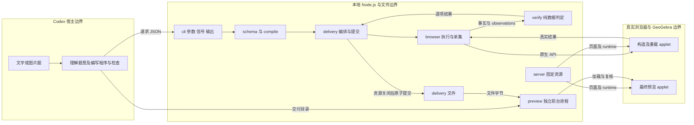
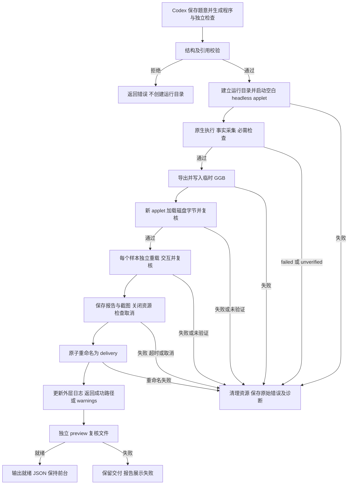
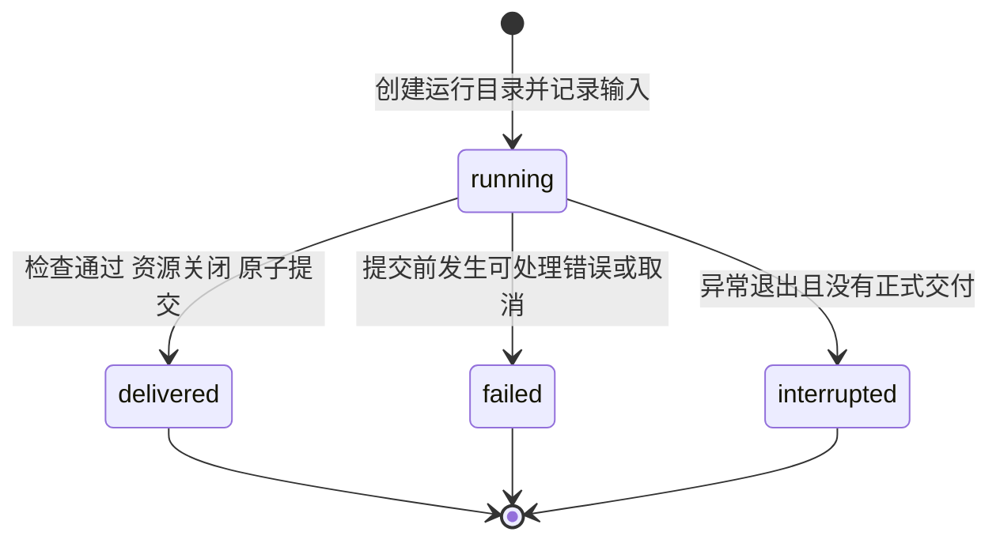
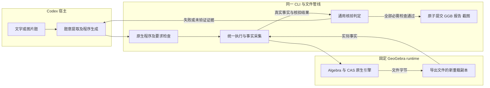

# ggb-plugins 独立工程设计

更新日期：2026-10-16。核对基线：提交 `59bf815`；数学执行实现来自 M6。

本文面向维护者，说明当前 M7 / 0.7.0 的架构、契约与交付门禁。M1–M7 是演进阶段，不是并行产品。第 1–12 节描述当前实现，第 13 节说明原生数学扩展及后续目标。入门阅读见 [开发实现介绍](ggb-plugins-implementation-guide.md)；操作方法见 [README](../README.md) 和 [安装说明](installation.md)。

源码和打包版本为 0.7.0。M7 保持 M6 的生产管线与交付格式，增加固定 runtime 覆盖记录，更新安装副本，并通过新的真实 Codex CLI 回合完成 Skill 自动选择到 GGB 交付。证据与边界见 [M7 记录](m7-validation.md)；M6 数学能力的历史验收见 [M6 记录](m6-validation.md)。

## 1 目标与范围

### 1.1 产品要求

| 编号 | 要求 | 可观察的完成条件 |
| --- | --- | --- |
| R1 | Codex 理解题意并选择构法 | 本地工具不调用额外模型 API，不要求 Provider Key |
| R2 | 保留文字或图片题的条件来源 | Codex 把题干及澄清存入请求；图片由宿主读取并转述，不传入 CLI |
| R3 | 每次从空白画布新建 | build 不加载外部 GGB，不续接活动画布 |
| R4 | 使用真实 GeoGebra 执行 | 实际对象存在、已定义；数值对象具有有限值；采集原生事实 |
| R5 | 按要求核验 | 非空 requirements 均有关联检查；failed 或 unverified 阻止提交 |
| R6 | 交付可重载 GGB | 新 applet 加载磁盘中的导出字节，重做检查并比较事实 |
| R7 | 展示交付文件 | preview 重载并复核后输出就绪 JSON，宿主保留前台进程 |
| R8 | 独立安装和运行 | 插件通过相对路径定位资源，不依赖开发 checkout |
| R9 | 新题通过输入程序表达 | 原生命令由固定 runtime 解析，不新增题型路由或逐命令包装 |

工具检查结构覆盖和来源片段，不能证明自然语言条件提取完整。Codex 必须逐项对照题干。图片引用没有独立 schema 字段；宿主需把来源说明写入 prompt 或 clarifications。

### 1.2 当前能力与边界

| 类别 | 已实现机制 | 保证边界 |
| --- | --- | --- |
| 原生数学 | Algebra 语句、CAS 表达式、嵌套命令和多输出 | 不设数学命令白名单，不等于全部命令已验收 |
| 数学检查 | 原生布尔、数值、嵌套数值／布尔数组；CAS 显式假设 | 不提供一般证明、条件解自动提取或题意完整性证明 |
| 事实 | 类型、定义、输入引用、坐标、线／圆参数、列表 data、滑块及样式 | 复杂局部绑定依赖仍可能为 unverified |
| 呈现 | 标签、颜色、可见性、线宽、线型、caption、fixed；图形或代数视图 | 无任意布局验收谓词；截图仅补充观察 |
| 采样 | 自由点／路径点真实拖动；数值滑块原生赋值 | 仅覆盖声明样本；参数赋值不证明鼠标能操作滑块 |
| 兼容输入 | 协议 2 中的 freePoint／command 回归编写形式 | 不能与 native 步骤混用；其有限命令表不限制 native |

外部 GGB 导入、活动画布续题、三维材料、宿主脚本和通用证明不在范围。CAS 保存当次计算的命名结果，不提供动态 CAS 单元。全命令覆盖及跨平台结果仍待验收。

### 1.3 术语

“必须”表示验收约束。“应当”表示默认选择，偏离时记录理由。“可以”表示可选行为。

| 术语 | 含义与代码标识符 |
| --- | --- |
| 要求 | requirement；含 id、source 和 checks |
| 方案 | plan；含 program、requirements、interactions 及可选呈现设置 |
| 程序 | program；本题的操作序列，原生步骤按输入顺序执行 |
| applet | 浏览器页面中的真实 GeoGebra 应用实例 |
| CAS | Computer Algebra System，计算机代数系统；本工具使用 GeoGebra 原生引擎 |
| 事实 | snapshot 返回的真实对象数据；expression 检查另有 observations |
| 探针 | 核验期间创建的临时原生对象，读取后删除并审计原对象 |
| 运行 | 一次 build 及其独立 ggb-* 目录；不跨调用恢复 |
| 交付 | 核验、重载、采样和资源关闭通过后提交的 delivery 目录 |

### 1.4 通用解原则

Codex 负责题目推理和独立检查的编写。GeoGebra 负责数学语法、命令重载和计算。TypeScript 工具负责执行边界、事实采集、判定及文件交付。

新增题目应当先更换程序和检查。只有缺少通用事实或交互能力时才修改工具，并增加反例。不得按题目关键词选择固定答案。不得把模型提交的 passed、截图或正确的静态坐标当作依赖证据。

## 2 独立仓库与代码组织

工程保持一个 TypeScript 包、八个生产模块和一个共享页面。

| 文件 | 所有权与责任 |
| --- | --- |
| [schema.ts](../src/schema.ts) | 请求结构、类型、容量限制、数学输入的副作用扫描和 ToolError |
| [compile.ts](../src/compile.ts) | 原生封装及引用检查；旧原语的类型检查、拓扑排序和编译 |
| [browser.ts](../src/browser.ts) | 浏览器／本地服务生命周期、原生执行、CAS 等待、事实与探针、交互操作 |
| [verify.ts](../src/verify.ts) | 消费事实和 observations，给出逐项状态及重载一致性判定；不调用浏览器 |
| [delivery.ts](../src/delivery.ts) | 运行目录、构造与重载编排、采样、失败诊断、提交及预览门禁 |
| [cli.ts](../src/cli.ts) | 参数、JSON 输出、进程信号及退出码 |
| [doctor.ts](../src/doctor.ts) | 复用浏览器 API，执行点和 CAS 的导出／重载冒烟，返回版本及限制 |
| [server.ts](../src/server.ts) | 仅供应 viewer 和固定 runtime 的本地 HTTP 资源 |
| [viewer/index.html](../viewer/index.html) | 构造、重载与预览共用的页面壳及 applet 参数 |

Skill 位于 [skills/ggb-construction](../skills/ggb-construction/SKILL.md)。examples 保存输入，tests 保存行为回归，scripts 保存安装和打包脚本。运行不读取其他 checkout。原 ggb_copilot 仅为历史参考；移植代码时仍需核对来源、依赖和许可证。

## 3 插件形态与架构

根 [plugin.json](../plugin.json) 声明本地执行。根 marketplace 指向当前插件目录，Skill 按客户端机制发现。安装包与资源定位见第 9 节。



模型请求和检查表达式均作为输入处理。schema 扫描宿主／脚本副作用；浏览器禁用材料 JavaScript、禁用下载，并拦截非本次服务来源的请求。执行后审计对象类型和脚本节点。这些是实现中的多层限制，不是任意 GGB 或任意脚本的安全认证。

server 仅监听 127.0.0.1，检查 Host、Origin 和请求方法，通过真实路径限制 runtime 资源。server 不提供通用磁盘读取，也不直接供应产物目录。CLI 读取 GGB 后调用 applet API 加载。

## 4 输入、方案与 GGB 导入策略

### 4.1 build 请求

当前请求协议为 2，CLI 结果信封协议为 1，交付清单协议为 2。这三个版本字段属于不同边界，不能混用。

| 字段 | 必填性与约束 |
| --- | --- |
| protocolVersion | 必填，字面值 2；协议 1 拒绝 |
| prompt | 必填，非空原文；最多 12000 字符 |
| clarifications | 可选，最多 20 个 question／answer 对；显式 null 拒绝 |
| locale | 必填，最长 32 字符的语言提示；不自动翻译诊断 |
| outputDir | 必填，产物父目录；应使用用户工作区绝对路径 |
| plan.program | 必填，1–64 个步骤 |
| plan.requirements | 必填，1–64 项；检查总数最多 256 |
| plan.interactions | 必填，0–12 个样本；sampled 检查需交互证据 |
| plan.styles | 可选，每个已声明对象最多一组设置 |
| plan.display | 可选，graphics 或 algebra；缺省 graphics |
| plan.view | 可选，xMin、xMax、yMin、yMax；执行器补足视野以保持等比例 |

未知字段拒绝。要求的 source 必须是 prompt 或澄清中的原文片段。表达式的 subjects 必须是程序声明对象，并在表达式词元中出现；这不是自然语言或完整数学语义证明。CAS assumptions 也必须来自输入原文。

### 4.2 原生构图程序与检查

| 对象 | 契约 |
| --- | --- |
| native 步骤 | id、op 为 native、mode 为 algebra 或 cas、source 为一条原生语句 |
| outputs | 可选，1–16 个名称且包含 id；缺省为 id；必须完整匹配原生返回标签 |
| initial | 可选二维坐标，仅用于初始化实际可移动点；约束仍由 GeoGebra 保持 |
| expression 检查 | kind、subjects、scope、expression、mode、expected；CAS 可选 assumptions |
| expected | 有限数值、布尔值或嵌套数组；最多 256 个节点、深度 8 |
| assumptions | 仅 CAS，1–8 条来自输入的数学条件；保存为结论的范围 |
| scope | initial 在构造与重载检查；sampled 还在每个交互副本中检查 |

原生步骤顺序执行，不接受混合旧原语的程序。Algebra 采用异步原生输入接口，等待按需数学模块加载。CAS 仅在使用时等待就绪；计算结果再物化为命名原生对象。输出已存在、未定义、返回标签缺项或隐式新增独立参数会使执行失败。附属对象仍进入快照。

对象名最长 32 字符，允许原生末尾下标，如 B_{1}。e、i、x、y、z、pi 及 GgbProbe 前缀保留。保留对象名不妨碍在数学表达式中使用相应变量。中文显示名使用 caption。原生数学输入不要使用 JavaScript 的 1e-7 数值写法，采用普通十进制或 10^(-7)。

以下为可通过结构校验的完整最小代数请求。它同时检查列表的实际结构值：

```json
{
  "protocolVersion": 2,
  "prompt": "求 x²-5x+6=0 的实数解。",
  "locale": "zh-CN",
  "outputDir": "/tmp/ggb-example",
  "plan": {
    "program": [
      {"id": "roots", "op": "native", "mode": "cas", "source": "Solutions(x^2-5x+6=0,x)"}
    ],
    "requirements": [
      {"id": "solutions", "source": "求 x²-5x+6=0 的实数解", "checks": [
        {"kind": "expression", "subjects": ["roots"], "expression": "Sort(roots)", "mode": "algebra", "expected": [2,3], "scope": "initial"}
      ]}
    ],
    "interactions": [],
    "display": "algebra"
  }
}
```

完整字段以 [schema](../src/schema.ts) 和 [能力契约](../skills/ggb-construction/references/capabilities.md) 为准。图形、代数、函数及统计实例见 examples。新数学关系优先采用原生表达式；旧几何谓词继续用于可复用检查。

### 4.3 GGB 导入策略

build 只从空白 applet 开始。它不接受材料 URL、Base64、外部 GGB 或活动浏览器画布作为基线。工具只重载本次导出的字节；preview 只接受符合当前清单和报告门禁的交付目录。

清单与摘要检查文件一致性，不认证第三方文件的来源。外部导入留待独立设计，需先定义解压容量、脚本、自定义工具、外部资源、对象冲突、动画及原文件不变的规则。当前不提供该导入管线。

## 5 工作流程与有界修复



没有交互样本时，G 不执行拖动或参数赋值。graphics 视图仍检查原生按钮缩放；algebra 视图记录 not_applicable。提交后的日志失败产生 warnings，不进入提交前失败路径。

工具每次执行一个程序，不自动调用模型修复。Skill 最多尝试三次新 build；每次保留要求并创建新目录。失败后不修改半完成画布，不自动重放或续接。

## 6 画布生命周期与运行状态

### 6.1 资源生命周期

build 拥有本次服务、浏览器、构造 applet 和重载副本。每个采样副本使用后关闭。所有交付检查使用 headless Chromium。preview 使用独立进程；默认用本机 Google Chrome，--headless 使用测试 Chromium。

browser 接收 AbortSignal；CLI 拥有 SIGINT、SIGTERM 和退出码。启动及上下文准备受时限约束。取消后关闭已取得资源，迟到的原生启动结果由完成处理器关闭。doctor 清理后再次检查取消及总时限。强制杀进程或系统崩溃不保证活跃浏览器被回收；不自动恢复残留会话。

预览就绪后，CLI 监听页面关闭和浏览器断开，随后关闭专用浏览器和服务。宿主必须保留前台进程；一次性 codex exec 退出会回收其会话。预览编辑不写回交付文件。

### 6.2 最小运行状态



| 源状态 | 事件与守卫 | 动作及目标 | 所有者与依据 |
| --- | --- | --- | --- |
| 无 | 输入通过且运行目录建立 | 写 request.json、run.json；进入 running | delivery 的 build |
| running | 检查通过、资源关闭、未取消、rename 成功 | 正式交付生效；进入 delivered | delivery 的 build；manifest 是提交标记 |
| running | 提交前错误、超时或可处理取消 | 尽可能保存错误并清理；进入 failed | delivery 的 catch |
| running | 进程异常退出，且无有效 delivery | 读取方事后识别 interrupted；不恢复 | 文件事实；进程不保证能写终态 |
| 已提交但外层日志仍为 running | 更新 run.json 失败或进程在提交后退出 | 交付保持有效；可返回 warnings | 以有效 delivery 为准 |

这些状态属于一次构造运行，不属于预览窗口。初始化或诊断写盘失败可能没有完整日志。仅凭 running 不能判定进程已中断。终态没有恢复入口；重复请求生成新目录，不修改旧交付。工具没有并发状态迁移 API，也不做请求去重。

## 7 本地工具契约

| 命令 | 提供方与消费方 | 输出及完成条件 |
| --- | --- | --- |
| doctor | CLI 提供，Skill／安装器消费 | 点及 CAS 的导出重载通过、资源关闭后，输出版本、smoke、casSmoke、限制及能力说明 |
| build --request FILE | CLI 提供，Skill 消费 | 读取协议 2 JSON；成功返回 delivery、file、report，必要时附 warnings |
| preview --delivery DIR [--headless] | CLI 提供，宿主进程会话消费 | 清单、报告及实际重载检查通过后输出 url、delivery；保持前台直到关闭或取消 |
| demo [--output DIR] | 源码开发快捷入口 | 使用 triangle fixture 调用同一 build；发布包不宣传该入口 |

成功信封为 `{protocolVersion:1,ok:true,data}`。失败信封为 `{protocolVersion:1,ok:false,error:{code,message,details?}}`。preview 就绪前失败写标准输出；就绪后异常写标准错误，保留唯一就绪信封。正常成功退出码为 0，失败为 1，CLI 取消为 130。

错误码包括 invalid_input、unsupported_operation、runtime_unavailable、execution_failed、verification_failed、verification_unverified、export_failed、reload_failed、preview_failed、limit_exceeded、cancelled。原始 ToolError 可以穿过上层封装；具体码还取决于失败阶段，不能只凭码假定资源或文件状态。build 在创建目录后尽可能附带 details.run、stage、cause 和 diagnostics。

| 限制 | 当前值与依据 |
| --- | --- |
| 请求文件／题干 | 128 KiB／12000 字符；schema limits |
| 程序／要求／检查／交互样本 | 64／64／256／12 |
| 原生 source、expression、单条 assumption | 最多 8192 字符；单条语句，不接受换行或分号 |
| 坐标及参数样本值绝对值 | 不超过 10000；视野端点绝对值不超过 20000 |
| GGB／报告 | 10 MiB／16 MiB |
| 嵌套 expected 及读取结构 | 256 个节点，深度最多 8 |
| 单次等待／build 总时限／doctor 总时限 | 30／120／45 秒 |

限制的权威来源是 schema 与 browser；doctor 输出 limits。expected 的数值只要求有限，不沿用坐标上限。数学命令内部的原生参数并未全部由 schema 检查。时限不代表系统崩溃或阻塞式引擎计算的硬实时终止保证。

## 8 构造依赖核验与 GGB 交付

### 8.1 事实、检查与结论

| 证据 | 采集和判定 | 结论范围 |
| --- | --- | --- |
| 对象事实 | API／XML 读取类型、定义、输入、坐标、值、样式、滑块等 | 描述实际 applet，不接受计划或截图替代 |
| 依赖 | 读取明确输入引用，排除函数形参；verify 遍历传递依赖 | 复杂局部绑定或不明确参数为 unverified |
| 原生表达式 | observe 创建临时探针；检查实际类型、定义和数值／data | 只证明声明表达式在声明范围下的结果 |
| 假设 | CAS 用原生 Assume 计算，保存 assumptions 和结果 | 不自动证明假设，也不自动提取完整定义域 |
| 交互 | 每个样本重新加载文件后修改，复核 sampled 检查 | 有限样本，不是全域证明 |

探针在当前检查 applet 中临时创建，不是每条检查都新开隔离浏览器。observe 和复杂值采集删除临时对象后，核对原对象 XML 未变；污染失败不能继续交付。破坏性的交互检查只在独立重载副本中执行。

列表与矩阵通过 Length、Element 和实际类型读取为 data，不通过打印文本还原数值。只有有限数值、布尔值及其嵌套数组可直接与 expected 比较；其他元素需另写原生检查。布尔 false 不与数值 0 混同。Algebra 条件表达式按实际结果判定，不因输入中出现问号而直接拒绝。

verify 输出 passed、failed 或 unverified。数值容差为 `1e-8 * max(1, abs(scale))`；各谓词选择对应 scale。误差在容差内通过，超过十倍容差失败，中间灰区未验证。结构类型不匹配或证据缺失不能通过；非退化检查有独立判据。每项结果含 requirementId、checkId、subjects、method、scope、status 和 evidence。

### 8.2 导出与重载

1. 构造核验通过后，用 getBase64 回调取得 GGB 字节。
2. 将字节写入 delivery.tmp/result.ggb，并读取同一磁盘文件。
3. 新 applet 用 setBase64 回调加载字节，不重放构图程序。
4. 重新采集事实和 observations，核验要求并比较构造与重载摘要。
5. 每个交互样本独立重载；报告 method 区分 mouse 与 native_value。
6. 保存重载后、交互前的 preview.png 和报告，复核原画布未变。
7. 关闭构图资源，检查取消，原子重命名为 delivery。

独立圆锥曲线等对象必须保留数学定义，不能因 independent 而丢弃方程。已有完整数值事实的独立点、数值、布尔、线／圆可通过相应事实比较。身份与依赖精确比较，数值采用固定容差；不比较全部原始 XML 字节，也不建立通用语义哈希。

runtime 在重载时会规范化部分代数对象的默认标签标志。比较器排除 numeric、list、boolean 的这类默认标志，显式样式仍重新核验。符号数学等价通过原生表达式／CAS 检查；保留部分 valueString 作为重载一致性证据，不把打印文本等同于符号证明。

### 8.3 产物与预览

```text
<outputDir>/ggb-*/
  run.json                     外层运行日志，可能滞后于提交事实
  request.json                 原始请求及条件来源
  verification.json            已产生的构造或采样证据；失败时可能不完整
  delivery.tmp/                未提交产物；失败时可以保留
  delivery/
    result.ggb
    request.json
    verification.json
    preview.png
    manifest.json
```

当前 manifest 含 protocolVersion:2、milestone:M6、runtimeVersion、file、sha256、requestSha256 和 objects。报告含 construction、reload、interaction；每个核验阶段保存 objects、results、observations。交互样本保存输入、method、before 和 after。

preview 先检查必需文件、请求摘要、GGB 摘要、阶段报告及采样覆盖。它重算报告的判定，再在真实 applet 重做 initial 检查并比较 manifest 事实。preview 不重新执行历史交互样本，也不修改原报告。文件清单用于一致性，不是第三方材料认证。

M6 继续接受有效的协议 2 请求，协议 1 拒绝。preview 要求 M6 milestone；旧交付需重新构造以补齐当前证据，不建立旧报告兼容层。

## 9 运行依赖与安装

依赖为 Node.js 22+、pnpm 11、锁定的 Playwright、匹配 Chromium 和 GeoGebra 5.4.932.1。默认可见预览另需本机 Google Chrome；headless doctor 不验证 Chrome 安装。安装需要 curl、unzip，打包另使用 zip。

[setup-runtime.mjs](../scripts/setup-runtime.mjs) 从锁定官方 URL 或指定 ZIP 读取资源，核对压缩包 SHA-256 后解压。已有 runtime 不覆盖。启动核对安装元数据及实际 applet 版本；doctor 不重新认证全部已解压资源。

[setup-plugin.mjs](../scripts/setup-plugin.mjs) 在插件根目录执行。存在源码时安装构建依赖并始终重编译，包括旧／部分 dist；无源码 ZIP 安装生产依赖并使用已有编译产物。之后准备 Chromium 和 runtime，执行 doctor。

[package-plugin.mjs](../scripts/package-plugin.mjs) 生成独立目录、ZIP 及 SHA-256。包内包含编译模块、Skill、清单、页面、安装脚本、锁文件和许可，不含源码、测试、node_modules、runtime、Chromium 或用户产物。插件根路径由脚本位置定位，请求和产物写在用户工作区。

仓库还提供 [Release plugin 工作流](../.github/workflows/release.yml) 和 [v0.7.0 发布说明](releases/v0.7.0.md)。推送 v* 标签或手动输入已有标签时，工作流从目标标签检出。它校验标签与 package.json 版本，安装依赖，运行类型、构建及基础／打包测试，再打包。打包器另核对 plugin.json 与 package.json 的版本一致。

工作流先创建包含 ZIP 和校验文件的草稿 Release，再发布并标记 latest。发布说明来自 docs/releases/<tag>.md。该工作流不运行真实浏览器测试；发布包不能代替 M6 的本地数学验收或 M7 的客户端验收。实际发布状态及客户端证据分别记录在 M7 验收记录。

固定 Git 标签安装与跟随 main 的开发安装应当区分。更新固定版本时，重新注册目标标签；marketplace upgrade 不自动切换固定标签。其他本地工具可在解压后准备依赖并调用同一 CLI，但 Skill 自动发现由各客户端决定。不能只复制 SKILL.md 代替完整插件包。

安装阶段需要网络，运行浏览器限制为本次本地来源。没有断网装置验收时，不声明首次安装或全部运行完全离线。GeoGebra 许可独立于本项目 MIT，见 [第三方说明](../THIRD_PARTY_NOTICES.md)。M6 的 ZIP 检查不替代安装后客户端验收。

## 10 测试与验收矩阵

| 编号 | 场景 | 证据与范围 |
| --- | --- | --- |
| A1 | 独立安装 | 0.7.0 编译包安装后，真实 CLI 回合自动选用 Skill 并交付新题 |
| A2 | 宿主题目到交付及预览 | M4 CLI 运行时的自动选 Skill 完整回合；M5 安装副本执行；M6 源码 Chrome 就绪 |
| A3 | 条件错误 | browser、native、m6 测试拒绝错误关系／结果 |
| A4 | 静态坐标冒充依赖 | browser、native 的伪造中点及路径依赖反例 |
| A5 | 输入及副作用边界 | schema、native 测试；图片没有独立 CLI 入口 |
| A6 | 缺失、退化、灰区或未决 | 数值、列表、条件、缺失探针及参数退化反例 |
| A7 | 导出和重载 | 定义／事实比较、导出篡改、多输出、完整报告复核 |
| A8 | 故障及中断 | faults、startup 的取消、超时、写盘、清理、提交两侧 SIGKILL |
| A9 | 预览生命周期 | 文件不回写、页面关闭及取消释放服务、就绪后错误走 stderr |
| A10 | 发布能力正反例 | M6 跨域及参数样本；不代表官方全部命令 |
| A11 | 跨题复用 | M2 改名／旋转；M5 新组合；M6 插值与统计仅换输入 |

对应源码为 [schema 测试](../tests/schema.test.ts)、[server 测试](../tests/server.test.ts)、[package 测试](../tests/package.test.ts)、[browser 测试](../tests/browser.test.ts)、[native 测试](../tests/native.test.ts)、[M6 测试](../tests/m6.test.ts)、[faults 测试](../tests/faults.test.ts) 和 [startup 测试](../tests/startup.test.ts)。最终几何验收使用真实 applet；模块 mock 只用于故障注入，不在生产加入开关。

M6 验收记录报告：28 项基础测试、55 项构图测试、53 项故障与启动测试，共 136 项通过。这是已有记录，不是本次文档更新重新运行的结果。其他平台、桌面 UI 自动化、动态 CAS 单元及全命令覆盖未验收。

## 11 实施顺序与待确认事项

| 阶段 | 已完成工作或计划 | 状态与证据 |
| --- | --- | --- |
| M1 | 固定三角形、导出、重载及预览 | 已实现，历史记录 m1-validation |
| M2 | 可组合原语、统一执行和逐条件核验 | 已实现，m2-validation |
| M3 | doctor、故障清理、提交门禁 | 已实现，m3-validation；后续修复保留回归 |
| M4 | ZIP、marketplace、安装与客户端流程 | 已实现，m4-validation；源码安装始终重建 |
| M5 | 原生二维程序、CAS 结果持久化、表达式核验 | 已实现，m5-validation；独立定义及 Algebra/CAS 解耦已修复 |
| M6 | 异步模块、嵌套 data、假设、多输出、参数采样 | 已实现，m6-validation；数学管线沿用到 0.7.0 |
| M7 | 固定 runtime 覆盖记录、安装更新、真实客户端验收 | 已实现，m7-validation；目录 502 项，28 项有六个交付中的调用证据，其他未实测 |

| 待确认或后续事项 | 影响 |
| --- | --- |
| 其他宿主及桌面界面自动选择 Skill | 本次真实回合证据限定 macOS 的 Codex CLI；不推导所有客户端行为 |
| 其余命令及重载 | 目录映射已记录；未实测项不能推断可执行或可核验 |
| 复杂局部绑定与动态 CAS 单元 | 当前保守未验证或不提供，不能宣称动态依赖 |
| 定义域、条件解、任意布局的完整检查 | 由请求明确范围；没有充分证据时不得交付成功 |
| 外部 GGB 导入与续题 | 需独立导入边界设计，尚无执行入口 |
| 其他平台、桌面 UI 与掉电耐久性 | 当前 macOS／CLI 证据不覆盖这些行为 |

## 12 参考与设计覆盖

实现字段以 schema 为准，执行时序以 browser、delivery 和 CLI 为准。能力写法见 Skill；历史验收按 M1–M6 分别记录，不合并为全平台或全命令保证。官方参考链接保留在第 13 节及能力契约；本文的当前行为依据固定版本源码和仓库测试。

| 显性要素 | 位置 | 状态及依据 |
| --- | --- | --- |
| 架构与信任边界 | 第 2、3 节 | 已提供；八个模块、server、browser、viewer |
| 正常、拒绝及失败流程 | 第 5、8 节 | 已提供；delivery 的执行顺序 |
| 状态机与迁移表 | 第 6 节 | 已提供；run 日志和原子提交事实 |
| 请求、命令与持久化契约 | 第 4、7、8 节 | 已提供；schema、CLI、delivery |
| 验收与后续范围 | 第 10、11、13 节 | 已提供；M6／M7 记录 |

本文使用 STE 的中文清晰写作原则。完整规则和词典核对未完成，不声明 ASD-STE100 合规。Mermaid 保留可编辑图源；本次校验范围见文档更新的交付说明。

## 13 通用二维数学与代数目标

### 13.1 范围与完成含义

目标是让 Codex 按题生成 GeoGebra 原生程序，由同一条管线完成执行、核验、GGB 导出重载和展示。覆盖二维几何、解析几何、函数与不等式、参数与轨迹，以及方程、符号运算、微积分、列表、矩阵、数列、统计与概率等原生数学能力。复数和代数符号不因名称或维数表象被错误归为三维构图。

“支持全部二维数学和代数指令”表示执行接口不以手工维护的数学命令白名单限制 GeoGebra。命令语法、重载及计算由固定 runtime 负责；不表示任何数学问题都能求解、所有 CAS 输入都能得到闭式答案，或所有动态命题已获证明。具体命令及应用差异以[官方命令目录](https://geogebra.github.io/docs/manual/en/commands/All_Commands/)和固定 runtime 实测为准。未实现的原生命令必须报告运行时能力缺口，不能把它伪装成计算结果。

不属于数学命令开放范围的是三维构图、任意宿主 JavaScript、文件或网络操作，以及自动触发的点击、更新脚本。GeoGebra 的[脚本命令](https://geogebra.github.io/docs/manual/en/commands/Scripting_Commands/)还包含呈现设置；必要的样式设置通过统一呈现接口提供，不把数学程序入口变成宿主脚本执行器。执行边界包含输入扫描、浏览器请求拦截和材料审计，仍需按扩展补充反例，不能声称仅靠正则或短黑名单就完成隔离。外部 GGB 导入仍遵守第 4.3 节的独立边界。

同一命令可能有二维和三维重载，必须按实际对象维度及调用语义处理，不能按命令名一律拒绝。CAS 中出现 z 等代数变量，也不等于创建了三维对象。

图片题由 Codex 读取，将来源说明、题目转述、条件来源及歧义澄清写入 prompt／clarifications；CLI 没有独立图片或原图引用字段。之后与文字题进入同一接口。不得为图片题另写专用执行器。

### 13.2 原生程序接口与职责

M5 采用请求协议 2，增加原生数学程序入口。旧的结构化原语保留为回归编写形式，同样编译到一个执行器；不接受协议 1，不建立第二条交付管线。一个步骤提供稳定 ID、执行通道、完整原生语句及预期产物名称；由 GeoGebra 处理嵌套表达式、局部变量、命令重载和对象生成。原生步骤按程序顺序执行，不用逗号或简单字符串拆分重新解析 GGB 语法。

| 项目 | 当前契约（M5 引入，M6 扩展） |
| --- | --- |
| 输入与来源 | 保留 prompt、澄清、requirement ID、原文来源及输出目录；模型不得提交 passed |
| `program` | 步骤包含 `id`、`op:native`、`mode: algebra或cas`、`source`、可选 outputs 和 initial；不包含题型名 |
| Algebra 通道 | 使用原生输入接口执行数学语句，采集实际新增或变化对象；未知数学命令不因工具枚举缺项而预先拒绝 |
| CAS 通道 | 按实际使用等待就绪，物化当次结果；M6 检查可记录显式 assumptions，不提供持久 CAS 单元 |
| 产物约束 | 预期对象必须真实存在且已定义；同时记录多输出及附属对象，不以单一返回布尔值判成功 |
| 核验程序 | 按 requirement 声明对象关联、原生布尔或数值检查、符号等价检查及适用范围 |
| 限制与错误 | 保留容量、时限、取消和错误诊断；缺失、未定义、CAS 未决及数值灰区不得当作 true 或 0；Algebra 按实际结果判定 |
| 迁移 | 发布新协议并同步迁移 CLI、Skill 和 fixture；不默默改变协议 1 的含义，不维护第二套题型执行器 |

示意步骤 `p: y^2=4x`、`A=Point(d)`、`f(x)=sin(x)`、`g=Derivative(f)`、`roots=Solve(x^2=1)` 都是输入数据。它们不得分别触发 solveParabola、solveFunction 或 solveEquation 等生产分支。可调用协议见 [能力契约](../skills/ggb-construction/references/capabilities.md) 和 examples 中的完整请求。

GeoGebra 提供 `evalCommand`、`evalCommandGetLabels`、`evalCommandCAS` 和对象读取接口，见[官方 Apps API](https://geogebra.github.io/docs/reference/en/GeoGebra_Apps_API/)。CAS 返回字符串不等于已经产生可持久化的 CAS 单元。需要交付的代数结果必须进入原生对象或 CAS 单元，并验证导出重载后的结果；M5 采用当次 CAS 结果物化为命名原生对象，不提供持久 CAS 单元或动态 CAS 输入依赖；不能只保存在进程日志中。



继续使用一个包和现有模块边界。schema 检查请求结构；compile 检查程序封装及引用约束，不再复刻 GGB 命令类型系统；browser 负责原生执行、CAS 就绪和事实采集；verify 负责结果判定；delivery 保留清理、提交及预览门禁。GeoGebra 是唯一数学解析和计算引擎，不增加 Python、第二套 CAS、MCP 或常驻服务。

### 13.3 通用核验与交付

| 层次 | 统一检查方法 | 结论边界 |
| --- | --- | --- |
| 执行 | 原生返回值、实际对象集合、定义有效性、二维范围及步骤副作用 | 程序在固定 runtime 中完成，不等于题目条件正确 |
| 构造与依赖 | 原生类型、命令、表达式定义和 XML；核对用户指定依赖及参数变化 | 不再把未知于工具命令表的合法定义判为失败；无法解释的依赖证据返回未验证 |
| 数学条件 | GeoGebra 布尔、数值表达式及 CAS 等价计算；保存结果、假设和观察对象 | 数值采样、原生符号判定和一般证明分别记录；不相互冒充 |
| 交互 | 对真实可交互点、路径点和参数采样，读取联动事实 | 不再限制只有独立自由点可测；只声明已测范围 |
| 重载 | 实际加载同一 GGB，重新读取定义、结果、属性及必需条件 | 不以重新运行原程序代替重载，不只比较截图或格式化字符串 |

核验接口不能直接把 `getValue` 返回的 0 解释为有效 false；缺失或不适用对象也可能产生 0。布尔、数值及列表探针在当前检查 applet 中临时计算。适配器检查实际类型和定义有效性，读取后删除临时对象，并核对原对象 XML 未变，再交给 verify 判定。交互操作使用独立重载副本。探针审计失败阻止交付。CAS 等价不能只比较打印字符串；必须交给原生符号引擎。需要假设时，M6 检查显式声明并记录 assumptions；未决结果返回 unverified。

构图程序和核验程序分开保存。每个必需要求都必须关联检查和实际证据；恒真常量不能代替检查。Codex 仍负责逐项对照题干，工具不宣称自动证明自然语言条件提取完整。参数联动和真实依赖检查继续阻止“固定坐标冒充动态构造”。

纯代数题允许没有自由点、没有鼠标拖动样本。交付必须展示原生代数对象或 CAS 结果，而不是空画布；截图和预览通过 display 选择 Graphics 或 Algebra 视图；当前没有 CAS 视图枚举。随机对象、分支选择、定义域、复数域及条件解必须明确记录，不能静默确定唯一解或隐藏初始化未完成。

正常流程为：理解题意 → 生成原生程序及独立检查 → 等待相应引擎就绪 → headless 执行与核验 → 导出 → 新副本重载及交互检查 → 关闭资源 → 原子提交 → Chrome 展示。任一必需检查失败或未验证，仍进入第 5 节有界修复，不生成成功交付。第 6 节运行状态和清理规则保持不变；所有验证 headless，最终预览关闭后退出专用浏览器及本地服务。

### 13.4 实施顺序与验收

| 阶段 | 工作 | 退出条件 |
| --- | --- | --- |
| M5 | 已实现最小完整原生管线：新协议、原生命令及表达式、CAS 就绪与结果持久化、通用检查、导出重载和预览 | 抛物线题及纯代数题都通过同一 build/preview 完成交付；不依赖旁路脚本或开发 checkout |
| M6 | 已扩展通用事实及交互覆盖，补齐复杂输出、符号条件与失败门禁 | 函数、不等式、路径点、滑块、列表矩阵、微积分和统计等跨域输入复用冻结接口；不按命令添加包装 |
| M7 | 固定 runtime 命令覆盖记录、插件更新和真实客户端验收 | 发布时区分官方目录、runtime 实测、核验范围及剩余缺口，不用少量样例宣称全部命令验收完成 |

M5–M6 已跑通统一管线。后续仍不提前建设完整手册镜像、表达式解释器或复杂插件框架。M1 三角形及既有失败、取消、导出、清理、原子提交和关窗回归继续保留，迁移后仍走同一管线。

泛化验收冻结生产代码，随后只更换程序、对象名、参数和检查，覆盖圆锥曲线、函数图像、求解、符号运算、列表矩阵和无图形代数题；还必须包含一个实现阶段未指定的新组合。新增数学命令不要求修改工具源码。反例覆盖语法错误、CAS 未就绪、原生返回成功但对象未定义、条件解被误当无条件解、多个输出遗漏、退化与分支跳变、三维对象混入、核验探针缺失及依赖造假。

2026-10-16 的 headless 调查确认：固定 runtime 可原生创建函数、导函数、矩阵、行列式和数列，并重载这些对象。Solve 初次执行返回 true，但 CAS 未就绪时对象未定义；等待 CASLoaded 后得到解集并成功重载。evalCommandCAS 的 Factor 返回正确因式分解字符串，但未创建 CAS 单元。这些仅是原生接口调查，不是通用插件能力或全部命令的发布验收。

M5 保持原八个 src 模块及单包结构，未增加运行依赖。临时原生探针读取类型、定义和结果，删除后审计原对象不变。复杂局部绑定的依赖证据保守返回 unverified。原生 Algebra 会规范化数值、列表和布尔对象的图形标签标志；一致性不比较这些默认标志，显式样式仍逐项核验。完整快照保留在报告中，纯代数不执行不适用的画布缩放。实际验收见 M5 记录。

### 13.5 M6 事实与交互扩展

M6 保留协议 2、原八个生产模块和同一 build/preview 管线。原生构造与探针使用引擎异步输入接口，按需加载数学模块，单次等待受时限约束。CAS 仍按实际使用等待。新输入不增加数学命令包装。

| 扩展 | 输入与证据 | 失败门禁 |
| --- | --- | --- |
| 复杂值 | expected 可为嵌套数值／布尔数组；事实和观察记录实际 data | 逐元素检查类型、容差及灰区；未定义或不支持的元素不能作为 0 |
| 符号假设 | CAS 检查声明来自输入原文的 assumptions；原生 Assume 计算后保存假设及结果 | 未决符号、缺少假设证据、增加题外假设均不能通过 |
| 多输出 | outputs 完整匹配原生返回标签；允许原生下标名称 | 遗漏返回对象、未定义对象、隐式新增独立参数均拒绝 |
| 参数采样 | interactions 可声明 parameter/value；每个样本独立重载 GGB | 只接受独立、可移动、未固定的数值滑块；越界、未变化及退化失败 |
| 依赖 | 从原生函数声明排除形参，保留明确的参数引用 | 复杂局部绑定仍返回 unverified，不推测真实依赖 |

列表／矩阵通过原生 Length、Element 和对象类型读取。这是统一复杂值采集，不按题目或业务命令建立包装。每个结构最多 256 个节点、深度最多 8；删除临时对象后核对原对象 XML。数值对象即使被 runtime 标记为已定义，也必须具有有限数值。

报告区分 mouse（真实点拖动）和 native_value（原生参数设置）。参数设置不证明鼠标能够操作滑块，也不是全参数域证明。Algebra 视图允许参数采样，不执行画布拖动或缩放。假设只限定结论范围，不证明假设本身或条件解提取完整。

运行状态、先清理后提交、提交后日志 warning 和预览关窗清理沿用第 6 节。交付 milestone 改为 M6；旧协议 2 请求仍可执行，旧交付目录须重新构造以补齐证据。跨域输入及失败验收见 [M6 记录](m6-validation.md)；M7 已更新插件、建立命令目录与实际交付映射，并验证真实 CLI 回合；不宣称全部命令及重载已验收。

### 13.6 M7 覆盖与客户端验收

M7 不改变八个生产模块、请求协议 2 或 M6 交付格式。开发工具 `pnpm coverage:commands` 经同一 build／headless preview 管线生成六个跨域交付和命令调用记录。官方目录快照只保存名称、日期及来源摘要，不构建手册镜像，也不作为执行白名单。记录区分程序和检查调用、Algebra／CAS、成功交付样例与未实测项。具体重载、原生对象、核验条件和剩余缺口见 [覆盖记录](command-coverage.json) 及 [M7 验收](m7-validation.md)。

本机 0.7.0 编译插件由全新 Codex CLI 回合自动发现并选用 Skill，完成椭圆路径点、切线和列表统计的新组合。失败时仅修正输入程序，未改生产代码；原生附加输出未定义仍被门禁拒绝。自动验证全程 headless 并保存截图；最终 Chrome 展示由持续运行的调用方负责，不由一次性 exec 保持窗口。
