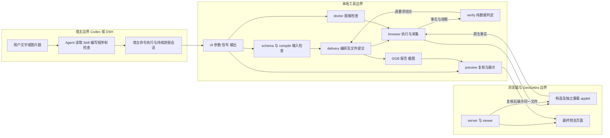
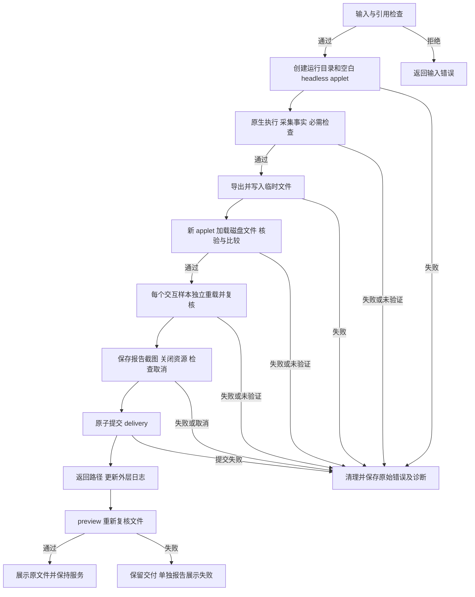
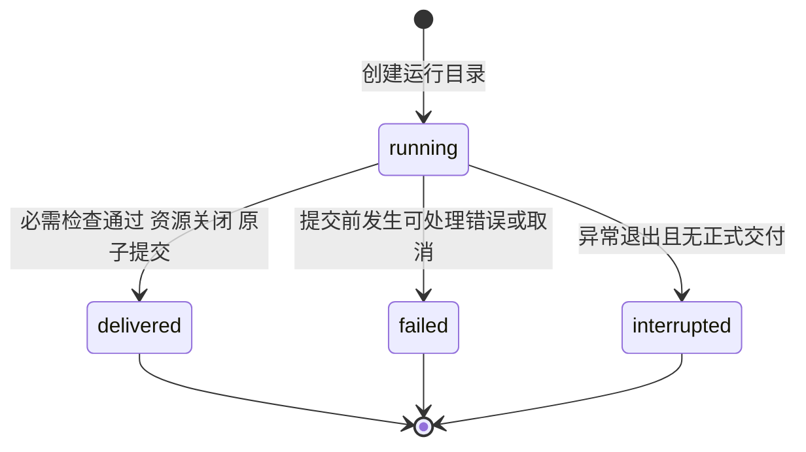

# ggb-plugins 需求与设计

本文只维护需求、责任边界、设计思路和取舍。用户操作见 [README](../README.md)，构建与维护见 [AGENTS](../AGENTS.md)，版本演进及验收入口见 [CHANGES](CHANGES.md)。设计面向当前工作区；已发布行为与未发布改动在修改记录中区分。

## 1 需求与范围

### 1.1 产品要求

| 编号 | 要求 | 验收原则 |
| --- | --- | --- |
| R1 | 从文字或图片题生成可交互二维数学文件 | 保存原文、条件来源与澄清，交付真实 GGB、核验报告和截图 |
| R2 | 跨题复用 | 新题通过原生程序与检查表达，不增加题型路由或逐命令包装 |
| R3 | 使用真实 GeoGebra | 实际对象存在、已定义，并从原生引擎读取事实 |
| R4 | 按要求核验 | 必需条件失败或证据不足时，不提交正式交付 |
| R5 | 文件能独立重载 | 新 applet 加载导出文件，重做条件检查并比较数学内容和依赖 |
| R6 | 保持可交互关系 | 保存原生依赖；适用时用真实拖动或参数样本检查联动 |
| R7 | 在 Codex 与 DSH 中独立安装 | 分别满足宿主发现与加载契约，不依赖另一个客户端或开发 checkout |
| R8 | 过程不打扰用户 | 自动验证使用 headless，保存截图；成功后才展示最终预览 |
| R9 | 工程保持简单 | 复用宿主推理与调度，保持本地单包及同一执行／交付管线 |

工作语言支持中文和英文。Agent 根据用户偏好和上下文选择回复、讲解及图中文字的语言，并以 locale 传给最终预览。题目原文、条件来源与假设保留原语言；命令、协议字段和错误码使用固定名称，原始诊断由 Agent 用所选语言解释。项目 README 默认英文，README.zh-CN.md 提供中文入口；其他文档保留中文。

图片由宿主读取并转述；本地工具不负责视觉理解，也不证明自然语言条件提取完整。Agent 必须逐项对照题干，不能把图形比例当作已知条件。

插件的用户输出限于题意分析与作图，不提供题目答案。具体边界由 [Skill](../skills/ggb-construction/SKILL.md#分析与作图边界) 约束宿主的回复及可见产物；底层计算、证据记录和数学核验门禁保持完整。这是宿主行为约定，不是 CLI 对自然语言答案的自动识别或过滤能力。

### 1.2 数学能力与保证边界

原生入口面向二维几何、解析几何、函数与不等式、方程、符号运算、微积分、列表矩阵、数列及统计概率。GeoGebra 负责语法和重载，工具不维护数学命令白名单。是否执行、能否核验、是否已有验收证据是不同问题，不能从少量成功输入推断全部命令可用。

三维构图、任意宿主脚本、文件或网络副作用、外部 GGB 的结构改写或续题、活动画布续接和一般数学证明不在当前范围；对已有 GGB 的显示属性编辑按 [4.4](#44-ggb-属性编辑p0) 的边界接入。复数或 CAS 变量不因名称被归为三维对象；维度由实际对象和调用语义判断。

条件解、定义域、分支和随机性必须明确。CAS 物化当次计算结果，不承诺动态 CAS 单元。复杂局部绑定无法确定依赖时保留未验证结论；有限采样不等于全域证明。

## 2 核心设计思路

**让宿主编写程序，让 GeoGebra 解释数学，让本地工具管理证据与交付。**

- 宿主拥有题目理解、模型凭据、对话和修复循环，本体不再建设第二个 Agent 服务。
- 原生命令和表达式作为数据进入统一接口。新增数学问题先改变输入；只有缺少通用事实或交互能力时才扩展工具。
- 构造说明“怎么做”，检查说明“必须满足什么”。检查不得只复述构造步骤，模型自判 passed 和截图不能替代实际证据。
- 每次从空白 applet 新建，以独立文件交付收束副作用。采用临时目录和最后提交，不为尚不存在的远程协作建设事务、队列或恢复服务。

模型同时生成程序与检查仍存在遗漏题意或自证式检查的风险。结构与来源检查能约束输入，不能证明题意完整；这个限制必须在报告和宿主交付中体现。

## 3 架构与责任边界

插件是分发单元，Skill 是工作说明，doctor、build、preview 是同一个 Node.js CLI 的子命令。本插件不提供 MCP 服务，命令执行能力由宿主提供。

| 组件 | 拥有的责任 |
| --- | --- |
| Skill 与宿主接入 | 工作说明、技能发现、资源定位；不复制数学业务或接管模型循环 |
| schema／compile | 输入结构、引用、容量与副作用边界；不复刻 GeoGebra 数学类型系统 |
| browser | 引擎就绪、原生执行、事实与临时探针、交互、浏览器生命周期 |
| verify | 只消费数据，判定数学条件、依赖和重载一致性 |
| delivery | 编排检查、保存证据、错误诊断、提交和预览门禁 |
| cli／doctor | CLI 拥有进程信号与输出；doctor 复用浏览器能力检查环境 |
| server／viewer | 供应固定本地资源与本次受控预览，不提供任意磁盘读取或远程构图 API |

模型输入跨入执行边界后仍需检查。自动浏览器限制请求来源、禁用材料 JavaScript 与下载，并在执行后审计对象与脚本。服务仅监听回环地址，检查请求来源和资源路径。这些措施不构成对任意外部 GGB 或脚本的安全认证；用户浏览器也不受 Playwright 的网络控制。

## 4 输入与导入策略

### 4.1 请求的语义

请求必须保存题目原文、必要澄清、构图程序、逐要求检查及适用的交互样本。要求与假设必须能追溯到输入，明确初始构型、条件与验证范围。精确字段、限制和协议只维护在 [Skill 能力契约](../skills/ggb-construction/references/capabilities.md)，结构依据为 [schema.ts](../src/schema.ts)；本文不再复制字段表或完整 JSON。

### 4.2 原生构图程序与检查

Algebra 与 CAS 走同一执行管线。原生步骤按顺序交给引擎，不能通过简单字符串拆分重建数学语法。仅在实际使用 CAS 时等待就绪；输出必须完整且已定义，CAS 结果必须保存为可重载对象。

旧结构化原语仅为回归输入保留，随后进入同一交付管线；不继续扩展两套数学编写系统。具体程序示例保存在 examples，调用方式只在 README 解释。

### 4.3 GGB 导入策略

build 默认不接收外部材料或活动画布作为基线。导出后，只在独立 applet 重载本次文件；preview 接受完整且通过门禁的交付目录。对用户已有 GGB 的显示属性编辑属于唯一的外部基线入口，边界见 4.4；除此之外不得复用交付加载入口放开导入。

文件摘要用于一致性，不认证第三方来源。外部导入的前置条件（解压容量、脚本、自定义工具、外部资源、对象冲突、原文件不变）在 4.4 逐项给出结论，未结论的形态仍不开放。

### 4.4 GGB 属性编辑（P0）

已有文件 + 文字指令 → 新文件。目标是最小、可证明的改动：只改声明的显示属性，其余对象逐字段不变。增删对象、改坐标或数值、重命名、视图调整、拖动样本与结构改写不在 P0 范围，按新建构图处理。

状态来源仍是空白 applet，只是起点改为声明的基线文件：加载基线 → 采集基线与编辑后事实 → 导出 → 新 applet 重载比较。因此“每次从空白开始、以独立文件交付”的既有不变量不变，变化只在于起点不是空画布，而是带摘要的基线。

| 门 | 判定 | 失败码 |
| --- | --- | --- |
| 基线可信 | 文件摘要等于请求声明；归档条目、脚本、宏、图片/按钮/三维材料在静态审计中拒绝；原件只读 | `base_invalid`、`base_unsupported` |
| 基线可解释 | XML 对象全部出现在加载后事实中，且没有工具无法描述的对象类型 | `base_unsupported` |
| 补丁生效 | 每个 setter 后读回声明的字段，颜色按大写、填充按容差比较 | `edit_no_effect` |
| 差异受控 | 编辑前后字段级差异必须落在声明的对象×字段集合内；仅在定义中引用被编辑对象、且取到同一请求值的传播变化可以多出 | `preservation_violation` |
| 重载一致 | 导出文件在新 applet 重载后事实与编辑后状态相同，并重跑 requirement 检查 | `reload_failed`、`verification_failed` |

多边形的颜色与描边会同步到它的边对象，因此差异白名单允许一类受控传播：对象必须在定义或记录依赖中引用被编辑对象，且字段取到同一请求值；其余差异一律失败，传播项照常写入 `diff.json` 供用户核对。差异白名单由工具从 `edits` 计算，模型不能用检查或声明豁免；这是“模型自判通过不算证据”在编辑模式下的对应形式。请求仍需带 requirement 检查，但检查只证明请求的效果，不替代差异门禁。

**为什么不让模型把旧文件翻译成 native 程序重画**：30 个对象的文件在实测中重写需要 30 条语句，多边形自动标签（`a_1`、`cTri`）依赖创建顺序，文本、逐对象样式、标签样式、滑块区间都要转录；加载式改写的保真度是逐字段 0 差异，而转录式必然引入漂移，成本也高出一个数量级。编辑模式因此只承认“加载 + 补丁”。

**4.3 六项前置条件的结论**：解压容量沿用 10 MB 文件上限与 16 MB 单条目、32 MB 展开上限；脚本按 `geogebra_javascript.js` 只允许空 `ggbOnInit` 存根、XML 内 `<ggbscript>` 一律拒绝；自定义工具拒绝；外部资源（图片、按钮、输入框）拒绝；对象冲突不存在于 P0（不新增对象）；原文件复制进运行目录并前后比对摘要，交付内嵌 `base.ggb`。

**已知限制**：导出会把 `<gui>`/`<euclidianView>` 的窗口尺寸、分隔条与缩放浮点值归一化到当次视口，构造部分不变；第二次导出起字节稳定。带撇号或非 ASCII 字符的对象名（`L_2'`、`θ1`）可用于编辑与检查，XML 实体在读取时解码，但这些名字不参与表达式检查的 token 匹配。基线中未定义的对象允许存在，其存活由差异门禁保证。preview 会重新加载内嵌基线并重算差异，报告中的差异被删改即失败。

## 5 流程与画布生命周期

宿主按“发现并读取 Skill → 确认本会话 doctor 结果 → 编写请求 → check 结构预检 → build → 读取证据并必要修复 → 最终预览 → 交付”推进。工具执行一次请求，不自行调用模型。

本会话首次使用安装副本时执行完整 doctor；同一副本未变化时复用本会话结果。新会话、插件升级、runtime 重装或环境错误后重新执行。不依赖跨会话成功文件。build 和 preview 仍逐次检查运行时并执行全部数学门禁；doctor 复用不缓存构造或核验结果。

每个交互副本从原始文件独立开始，避免样本互相污染。参数样本在目标状态核验后，还在同一副本恢复原值，重新核验并比较完整初态快照；这样可以观察增长后收缩等历史状态。结束前确认原构造未变。没有交互要求的纯代数题可以不执行拖动，图形操作不适用时明确记录原因。

delivery 最多提前初始化下一份采样 applet，与当前样本的重载、拖动和核验重叠。鼠标操作与检查保持串行。每个样本仍使用不同页面，加载原文件并记录 before／after；不复用上一样本的画布。预加载页面属于同一 browser 会话，取消或失败时由会话统一关闭，预加载失败不能作为样本成功。

真实拖动前，browser 检查目标附近其他可见且可移动的点；歧义目标提前失败，并保存坐标、冲突对象和失败截图。未移动等待仍有原时限，不用原生赋值代替鼠标。

browser 通过 AbortSignal 接受取消，CLI 管理进程信号。清理必须幂等，保留首个错误，把清理失败附为诊断。启动等待需要及时受时限和取消约束，迟到的原生启动结果仍要回收。doctor 在清理后再判断取消与时限，不能提前返回成功。

Skill 的修复有上限，每次创建新运行并保留原始要求，不在残留画布续接。不得通过删除条件或放宽容差修复。跨重试要求保留目前由宿主工作流负责，不能声称 CLI 已强制冻结自然语言基线。

## 6 运行状态与提交边界

| 迁移或事件 | 守卫、动作与结果 |
| --- | --- |
| running → delivered | delivery 关闭构图资源后原子重命名目录，完整交付成为成功事实 |
| running → failed | 提交前失败，尽可能保存错误和清理诊断，不产生正式交付 |
| running → interrupted | 强制退出且无有效交付；读取方事后识别，不保证进程写入终态 |
| delivered 后日志失败 | 返回路径和 warning，不撤销成功；外层日志可能仍滞后 |
| 重试 | 新建运行，不从终态恢复，不复用半完成画布 |

预览是独立资源会话，不改变构图运行终态，也不写回 GGB。强制杀进程或系统崩溃不保证全部资源回收；当前没有恢复系统或掉电耐久性保证。

## 7 核验与展示的设计约束

| 证据 | 为什么需要 | 结论边界 |
| --- | --- | --- |
| 原生对象及数学定义 | 防止计划、显示文本或静态坐标冒充构造 | 独立圆锥曲线等对象也必须保留可辨别内容的定义 |
| 真实输入依赖 | 防止固定结果冒充动态关系 | 不明确的局部绑定不能推测为依赖 |
| 原生表达式与 CAS | 在唯一数学引擎中检查关系及符号条件 | 读取实际类型、定义和结果；不把源码字符或打印字符串当作计算结论 |
| 相关交互样本 | 检查关系随输入变化仍成立 | 鼠标动作与原生参数赋值分开记录；不代表全参数域 |
| 文件真实重载 | 检查持久化保留对象身份、内容、依赖与呈现 | 不重放构图程序代替加载文件 |

探针在检查 applet 中临时创建，读取后删除并审计原对象未变；破坏性采样在独立副本执行。复杂列表按实际类型及元素读取，避免把 false、0、缺失和未定义混同。

判定有 passed、failed、unverified 三种结果，后两种都阻止正式交付。身份、依赖及适用定义精确比较，数值使用固定容差；容差灰区保留未验证。不能靠放宽容差掩盖事实采集误差，也不能全面忽略定义或样式以规避重载失败。

文本对象在构造时显式设置 GeoGebra 重载采用的默认线宽 5，再应用用户样式。这个步骤固定输入，不扩大比较器的忽略范围。明确指定而无法重载保持的样式仍必须失败。verify 使用同一规范化与容差生成对象、字段、期望值和实际值的差异；delivery 在重载判定前保存两阶段证据，快照不一致时另存 snapshot-differences.json。诊断保存失败不能使不一致的文件通过。

preview 检查文件与报告完整性、摘要及覆盖，包括参数往返证据，重算报告判定，再对实际文件重做初始核验和事实比较；不重跑全部历史交互。自动化调用可以用 --headless --once，在完整预览复核后关闭资源并退出；可见预览保持持续会话。截图用于呈现观察，不能替代数学检查。展示必须在复核之后发生，且不改变正式文件。

文件加载以原生 setBase64 完成及可见视图为数据就绪条件，不再为每次重载编码并丢弃 PNG。真实拖动在鼠标操作前等待绘制帧，正式截图在重载核验通过后保留。原生结果核验、探针清理审计和真实鼠标动作均保留。

## 8 宿主兼容与依赖取舍

Codex 和 DSH 分别满足宿主插件格式，共用 Skill 与编译核心。适配层只负责注册和路径，不借用另一个宿主缓存，也不新增数学执行器。封装与路径契约集中在 [双生态说明](dual-ecosystem.md)，安装步骤分别见安装文档和 DSH 随包 README。

固定 GeoGebra 与浏览器版本有利于复现命令行为和证据。安装与运行就绪、技能发现、模型调用、题目交付必须分别验收；某一项成功不自动推导其他项。当前具体结果从 CHANGES 所链接的验收记录查询，不把测试数量或命令统计写入设计要求。

保持本地服务、单包与最后提交，可以满足当前从空白画布生成文件的范围。只有已有画布协作、未知跨进程副作用或远程多用户成为实际需求，才重新评估画布事务、持久回执和任务服务。[项目对照](ggb-plugins-implementation-guide.md)保留这项取舍的比较依据。

### 8.1 性能证据与优化边界

delivery 在外层 run.json 记录总耗时和阶段计时；browser 细分观察中的 CAS 就绪、原生探针、复杂值读取及快照采集耗时。verify 不访问计时器或写文件。计时属于诊断，不进入要求判定或交付摘要；已有请求、清单和正式报告协议不变。

预加载阶段可以与其他阶段重叠，不能把阶段时长相加当作端到端耗时。成功与可处理失败均尽可能保存计时；强制退出不保证写入。比较优化效果需使用同一输入、相同检查和独立重载，交替运行基线与当前实现。阶段口径、实测数据和剩余瓶颈集中在 [性能验收记录](performance-validation.md)，不将机器耗时写成产品保证。

当前优化限于减少无效重试、会话内复用环境冒烟结果、预加载一份独立页面及删除丢弃截图。没有引入常驻服务、跨运行浏览器池或数学结果缓存。CAS 和复杂列表仍按真实结果读取；细分计时不足以支持删除核验步骤。

## 9 后续设计问题

以下尚属拟议设计，不改变当前协议或成功判据：

| 优先级 | 问题与最小方案 | 责任及验收思路 |
| --- | --- | --- |
| 1 | 宿主可能在重试中漂移要求；先保留要求表及覆盖缺口 | Skill 记录来源、预期关系、范围和假设；确有持续漂移再设计本地跨重试契约，不冻结可修复的整个程序 |
| 2 | 无关采样不能验证目标联动；增加相关变化与反例 | browser 采集、verify 判定；覆盖静态伪造、遗漏条件、修改预期及导出后依赖变化 |

用户明确改变题意时建立新要求基线，不能把用户修订误报为程序修复。椭圆焦点弦及将军饮马的历史失败与本次复跑见性能验收；历史记录缺少字段差异时，不据此推断数学构造错误。完整定义域、复杂局部绑定、动态 CAS、外部导入及跨平台保证均需另行定义需求和验收范围。

### 9.1 验证宿主的分工

核心回归继续使用固定输入和统一 CLI。端到端验收以 DSH 的独立 headless profile 为主，安装当前构建的完整 TGZ，不借用 Codex 缓存。受影响案例通过后，每题三次使用不同新会话，仅提供文字题，不提供现成程序；宿主模型与工具耗时分别记录。Codex 保留安装、技能发现和代表案例兼容检查。实际结果与限制见 [DSH 主验证记录](dsh-primary-validation.md)。

## 10 文档依据与设计覆盖

输入与字段依据为 schema 和 Skill 能力契约；数学语法官方引用只在能力契约维护。工程操作见 AGENTS，用户操作见 README，历史和验收入口见 CHANGES。本文不充当安装手册、API 字段镜像或版本日志。

| 显性要素 | 位置 |
| --- | --- |
| 需求与边界 | 第 1、2 节 |
| 架构与责任 | 第 3、8 节 |
| 正常、拒绝及失败流程 | 第 4、5、7 节 |
| 状态与提交不变量 | 第 6 节 |
| 契约原则与后续设计 | 第 4、7、9 节；详细字段引用能力契约 |

本文采用 STE 的中文清晰写作原则，不声明 ASD-STE100 合规。Mermaid 保留可编辑图源；图表仅作静态核对；本次性能与核验回归见性能验收，不推导全平台或全部命令的保证。
