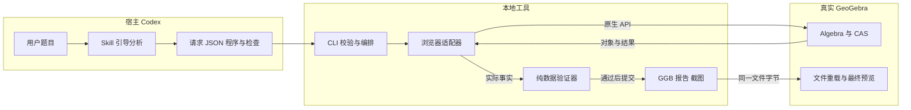
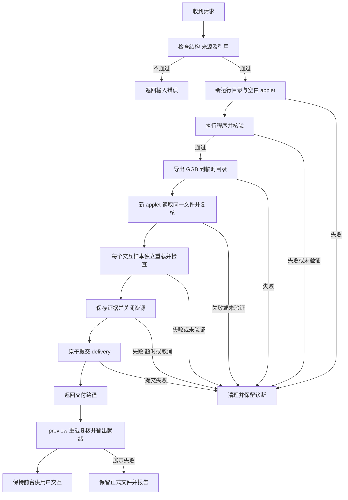
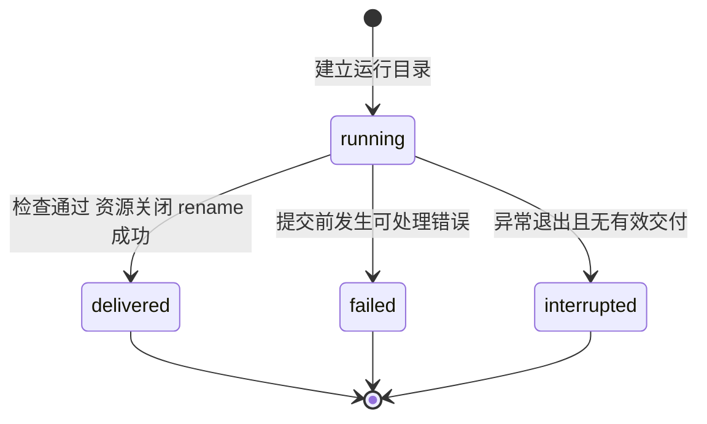

# 从一道数学题到可交互文件：ggb-plugins 的开发实现

面向同事的实现介绍。更新日期：2026-10-16。范围：当前 M7 / 0.7.0 源码（数学管线沿用 M6）。

这个工具把 Codex 的题意分析与 GeoGebra 的实际执行连接起来。Codex 编写数学程序和检查条件，本地工具运行程序、收集证据，最后交付可以重新打开的 `.ggb` 文件。用户可以在预览中拖动点、改变滑块或查看代数结果。

阅读本文不需要了解 Playwright 或 GeoGebra API。精确字段和时序见 [设计文档](ggb-plugins-design.md)；安装步骤见 [安装说明](installation.md)。本文依据当前源码、[能力契约](../skills/ggb-construction/references/capabilities.md) 和 [M6 验收记录](m6-validation.md)。源码与打包检查不等于安装后客户端验收；M7 的真实客户端证据见 [M7 验收记录](m7-validation.md)。

## 1 为什么不能只让模型画一张图

假设用户要求：“作三角形 ABC，取 AB 的中点 M，连接 CM。”

模型可以画出一个看起来正确的中点。但一张图不能说明 M 是否真正依赖 A 和 B。工具也可以直接创建固定点 M=(3,0)。在 A=(0,0)、B=(6,0) 时，这个坐标正确；移动 A 后，M 却可能留在原地。

工具需要交付三类结果：

| 结果 | 回答的问题 |
| --- | --- |
| 原生对象 | 点、线、函数或代数结果是否真实存在？ |
| 核验证据 | 当前关系、构造依赖和声明的样本是否通过？ |
| 可重载文件 | 关闭构图进程后，文件能否独立打开并保留这些事实？ |

截图用于看标签、颜色和布局，不能替代对象或依赖证据。`.ggb` 保存 GeoGebra 原生构造，用户可以继续交互。

## 2 三个参与者分别做什么

| 参与者 | 负责的工作 | 不应代替的工作 |
| --- | --- | --- |
| Codex 与 Skill | 读题、澄清歧义、选择初始构型、编写程序和独立检查 | 不提交自判的 passed，不删除无法验证的要求 |
| TypeScript 本地工具 | 校验请求、管理资源、采集事实、判定结果、提交文件 | 不按题型推理，不复制完整数学解释器 |
| GeoGebra | 解析原生数学语法、执行命令、维护对象联动、进行符号计算 | 不负责确认模型是否完整理解了用户原文 |

Skill 是给 Codex 的工作说明。CLI 是命令行工具。CAS 是计算机代数系统，负责因式分解、求解等符号计算。本项目使用 GeoGebra 自带的 CAS，不启动第二个数学引擎。



模型输出跨入本地执行边界后，工具先检查结构和限制。浏览器只访问本次本地服务，材料 JavaScript 被禁用，下载被禁用。输入还经过副作用扫描，执行后审计材料。这些措施有具体范围，不能据此把外部 GGB 当作可信输入。

## 3 “生成程序”在这里是什么意思

Codex 生成 JSON，而不是给宿主执行任意 JavaScript。JSON 中包含原生数学语句，以及与题目要求关联的检查。

下面是一个方案片段，不是完整 CLI 请求：

```json
{
  "program": [
    {"id":"A","op":"native","mode":"algebra","source":"A=(0,0)"},
    {"id":"B","op":"native","mode":"algebra","source":"B=(6,0)"},
    {"id":"M","op":"native","mode":"algebra","source":"M=Midpoint(A,B)"}
  ],
  "requirements": [
    {"id":"midpoint","source":"取 AB 的中点 M","checks":[
      {"kind":"midpoint","subjects":["M","A","B"],"scope":"sampled"}
    ]}
  ],
  "interactions": [{"point":"A","dx":60,"dy":-40}]
}
```

`source` 是交给 GeoGebra 的数学语句。`subjects` 指定检查哪些对象。`sampled` 表示除了原构型和重载，还检查声明的交互样本。完整请求另需协议、题目原文、语言和输出目录；requirement 的 source 必须来自题干或澄清。

新题可以更换为 `Derivative`、`Integral`、`Polynomial` 或其他固定 runtime 可执行的原生命令。工具不需要为每个题型增加 solveXxx 函数，也不需要为每个新数学命令增加 TypeScript 包装。

这里有两个执行通道：

- Algebra 接受对象、方程、函数和原生命令。异步接口等待 GeoGebra 加载所需数学模块。
- CAS 接受符号表达式。工具在使用 CAS 时等待就绪，再将结果保存为命名对象。

CAS 保存的是当次结果。参数以后改变时，这个物化结果不会自动变成动态 CAS 单元。需要联动的结果应通过 Algebra 原生依赖构造，并增加依赖及采样检查。

原生接口开放不等于全部命令已经验收。未知命令、未定义结果或无法建立证据的要求都不能当作成功。

## 4 一次 build 如何完成

构图过程中使用 headless 浏览器，即不显示窗口的真实 Chromium。只有最终预览默认打开 Google Chrome。



每个采样副本从原文件重新开始。因此，第二个参数样本不会继承第一个样本的变化。原始构造画布和待交付文件保持原构型。

没有交互要求的纯代数题可以用空样本数组。Algebra 视图展示原生结果，并记录画布缩放不适用。Graphics 视图会检查按钮缩放。

preview 会检查历史报告和样本覆盖，并重新执行 initial 检查。preview 不重新跑全部历史交互样本。用户在预览中修改对象，不会覆盖交付的 GGB。

## 5 工具如何知道结果正确

程序负责“怎么做”，检查负责“需要满足什么”。例如，程序用 Midpoint 创建 M；检查核对 M 的实际位置和输入依赖。对于其他数学问题，Codex 可以编写原生布尔、数值或符号检查。

| 检查层次 | 例子 | 能说明什么 |
| --- | --- | --- |
| 对象状态 | M 存在、类型为 point、已定义 | 对象可用，不代表全部关系成立 |
| 数学关系 | 中点坐标、长度、原生等价表达式 | 声明范围内的关系通过 |
| 构造依赖 | M 真实引用 A、B | 固定坐标不能冒充依赖 |
| 交互样本 | 拖动 A 后再检查 M | 这个真实拖动样本通过，不证明任意拖动 |
| 文件重载 | 比较原生定义、值和样式 | 文件保留了被检查的构造事实 |

通用表达式检查使用临时探针。例如，为了检查一个求和结果，工具让 GeoGebra 创建临时数值对象，读取类型、定义和实际值，再删除对象。工具核对原对象 XML 没有改变。探针污染原构造时，运行失败。

列表和矩阵按实际元素读取。工具用原生 Length、Element 和类型接口取得嵌套 data，不从显示文本还原数值。布尔 false 与数值 0 不互相替代。

符号检查可以携带 `assumptions`，例如 `x>0`。条件必须出现在用户输入或澄清中。工具用 Assume 计算并保存条件，结论只在这些条件下成立。工具不会自动证明条件成立，也不会自动找到遗漏的定义域。

验证器有三种结论：

| 状态 | 含义 | 交付结果 |
| --- | --- | --- |
| passed | 当前检查取得足够证据且符合判据 | 继续下一道门禁 |
| failed | 条件或结构检查不满足 | 阻止正式交付 |
| unverified | 证据缺失、类型不适用、符号未决或处于数值灰区 | 同样阻止正式交付 |

数值比较有固定容差，调用方不能放宽。当前基础容差为 1e-8，再按检查的数值规模调整。超过容差但未超过十倍容差的区域通常判为未验证；非退化检查有单独判据。详细公式见设计文档第 8 节。

## 6 M6 的参数采样与鼠标拖动有什么不同

点样本使用 `{point,dx,dy}`。工具向浏览器发送真实鼠标动作，再观察点的坐标是否变化。自由点和路径上的可移动点都可以检查。

参数样本使用 `{parameter,value}`。工具确认目标是独立、可移动、未固定的数值滑块，且目标值位于区间内。之后调用原生 setValue 并复核结果。

报告用 `mouse` 和 `native_value` 区分两类证据。原生赋值证明这个参数值下的关系通过，不能冒充“已用鼠标操作滑块”。同一滑块可以声明多个不同目标值，每次独立重载；这些样本也不能证明全参数域。

M6 还记录函数形参与实际输入引用。复杂局部绑定无法确定时，依赖检查返回 unverified。这个选择避免把不确定的字符串匹配当成真实依赖。

## 7 为什么要先关闭资源，再提交文件

构造正确但清理失败时，用户不应同时得到成功结果和失控的构图进程。工具因此把清理放在正式提交之前。



| 状态或事件 | 谁处理 | 文件事实 |
| --- | --- | --- |
| running | build 写日志并执行 | delivery.tmp 仍不是正式交付 |
| 提交成功 | build 原子重命名目录 | 有效 delivery／manifest 是交付标记 |
| failed | build 尽可能保存错误并清理 | 不把临时产物当作正式文件 |
| interrupted | 读取方事后识别 | 崩溃进程不保证写入终态，也不自动恢复 |
| 提交后 run.json 写入失败 | build 返回路径和 warnings | 正式交付保持有效，外层日志可能仍为 running |

状态属于构造运行。预览窗口关闭不会把 delivered 改成 failed。终态不恢复；重试创建新目录。

文件摘要使用 SHA-256，检查字节是否一致。摘要不能证明数学关系，也不认证第三方 GGB。数学关系由实际对象和检查负责。

## 8 同事从哪里开始读代码

| 关注问题 | 阅读入口 |
| --- | --- |
| 谁处理命令和取消？ | [cli.ts](../src/cli.ts) |
| 请求允许哪些字段？ | [schema.ts](../src/schema.ts) |
| 新数学命令为什么不用增加枚举？ | [compile.ts](../src/compile.ts) 的 native 分支 |
| 如何执行、等 CAS、读列表和做探针？ | [browser.ts](../src/browser.ts) |
| 如何给出三种结论和比较重载？ | [verify.ts](../src/verify.ts) |
| 如何保证正式文件最后才出现？ | [delivery.ts](../src/delivery.ts) |
| 如何确认安装可用？ | [doctor.ts](../src/doctor.ts)、[安装器](../scripts/setup-plugin.mjs) |
| 页面和本地资源如何供应？ | [server.ts](../src/server.ts)、[viewer](../viewer/index.html) |

这里的模块按照变化原因划分职责。数学语法变化由 GeoGebra 处理，验证规则留在 verify，文件提交留在 delivery，进程行为留在 CLI。工程没有引入常驻服务、任务数据库、第二套 CAS 或题型模板库。

旧 freePoint／command 写法仍为回归输入保留编译分支，随后进入同一执行与交付管线。新增功能优先走 native 接口，避免继续扩充两套数学能力表。

## 9 使用接口与维护约定

| 接口 | 输入 | 成功判据及副作用 |
| --- | --- | --- |
| doctor | 无题目输入 | 点及 CAS 导出重载通过，关闭资源；输出版本和限制，不交付文件 |
| build | 协议 2 请求 JSON | 检查通过且资源关闭后提交目录，返回文件路径 |
| preview | 当前 M6 交付目录 | 文件及报告复核、实际重载通过后输出就绪，保持前台 |

CLI 的结果信封协议为 1，交付清单协议为 2；它们与请求协议分别管理。旧协议 2 请求可以继续运行，但旧 milestone 的交付需重新构造。运行错误保留可用诊断，不能通过删条件或放宽容差重试。

源码开发中的常用命令如下。这里列出操作方式，不表示本次文档更新执行过这些运行命令。

```sh
pnpm check
pnpm build
pnpm test
pnpm test:browser
pnpm ggb doctor
pnpm ggb build --request examples/functions.json
pnpm preview --delivery /absolute/path/to/delivery
```

自动化预览加 `--headless`。最终可见预览使用本机 Google Chrome。宿主必须保留前台进程；一次性 codex exec 退出后会回收其会话。关闭预览标签页或窗口，会退出本次专用浏览器和本地服务。

插件发布也复用现有包。仓库的 [发布工作流](../.github/workflows/release.yml) 从版本标签检出，检查版本、类型、构建及基础测试后，上传编译 ZIP 和校验文件。手动发布同样指定已有标签，避免混入 main 的后续改动。发布说明见 [v0.6.0](releases/v0.6.0.md)。工作流没有执行真实浏览器验收，因此“已经发布”与“已完成客户端验收”是不同事实。本次只核对工作流源码，不查询远程发布结果。

其他本地工具也可以调用完整包中的 CLI。它们如何自动发现 Skill，需要各自验证；只复制 Skill 文件不能获得 CLI、页面和运行依赖。

维护一个新能力时，先编写能复用现有接口的输入。若事实或交互不足，再修改对应模块。至少增加成功、失败、文件重载和适用的依赖／采样反例。测试中的模块 mock 用来触发故障；最终构造正确性由真实 applet 验证。

当前限制包括请求 128 KiB、64 个步骤、256 个检查、12 个样本、GGB 10 MiB、报告 16 MiB。build 总时限 120 秒，doctor 总时限 45 秒，单次等待上限 30 秒。完整限制以 schema 和 doctor 输出为准。

## 10 已验证到哪里

M1 建立了三角形端到端链路。M2 把固定样例移成输入，建立可组合程序。M3 补齐清理和提交故障处理。M4 打包并验收客户端安装。M5 接入原生 Algebra／CAS。M6 扩展复杂值、假设、多输出和参数采样。

[M6 验收记录](m6-validation.md) 报告 136 项测试通过，并保存函数、统计、抛物线、代数、三角形及新组合的交付证据。这个数字来自已有记录，本次文档更新没有重新运行真实浏览器验收。

0.7.0 已完成编译包安装及真实 Codex CLI 自动选择 Skill 到新题交付的验证。M7 记录官方目录 502 项，其中 28 项有六个成功交付中的调用证据；其余未实测。少量成功样例不能代替全部二维命令和重载验收。

当前不提供外部 GGB 续题、三维构图、动态 CAS 单元、完整作用域解析或一般数学证明。对于没有充分证据的要求，工具返回未验证；Codex 必须说明缺口。

| 显性要素 | 位置与依据 |
| --- | --- |
| 架构与责任边界 | 第 2、8 节；生产模块及 Skill |
| 正常、拒绝及失败流程 | 第 4 节；delivery 执行顺序 |
| 状态机与迁移表 | 第 7 节；run 日志及提交事实 |
| 输入、输出及兼容性契约 | 第 3、5、6、9 节；schema、CLI、报告 |

本文已应用 STE 的中文清晰写作原则；完整规则和词典核对未完成，不声明 ASD-STE100 合规。Mermaid 图保留可编辑图源，渲染验证范围见本次交付说明。
