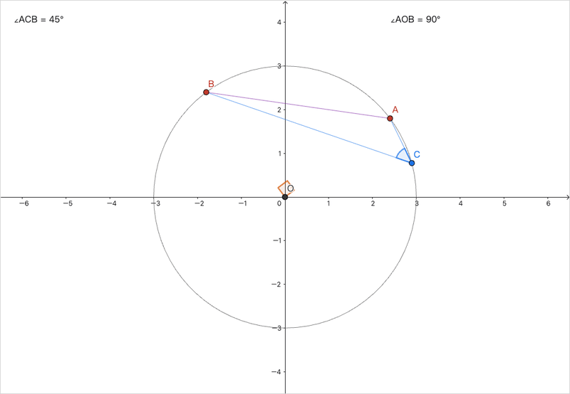

# GeoGebra Construction 0.9.0

**状态：准备发布。** 三端本地资产已构建；npm、GitHub Release 和分发仓库尚未发布。
本版不改变请求协议、GeoGebra runtime 或核验门禁，新增 DSH 交付卡片、DSH 安装引导、
运行时下载韧性和教师内容资产。



## 主要变化

- DSH 桌面 bundle 的 `engines.dsh` 改为只设下限 `>=0.2.1-rc.2`，不再因 0.2.2
  正式版或后续 0.2.x 被引擎检查拒绝；受限 SDK Server 入口仍只接受已验证的
  `0.2.1-rc.2`，两条路径分别验收。
- `ggb-setup` 随 DSH bundle 发布并注册为第二个 Skill。安装器增加 Node、pnpm、curl、
  unzip 前置检查；GeoGebra 下载改为 600 秒、5 次重试、断点续传，支持
  `GGB_RUNTIME_URL` 镜像，失败保留部分文件；doctor 成功时输出一行摘要。
- DSH 交付卡片：`ggb_delivery` 工具展示逐阶段通过数、失败原因和 `preview.png`
  缩略图；`/ggb-preview <交付目录>` 用系统浏览器打开交互预览；Agent 同时用 `present`
  声明 GGB、截图和报告。卡片只读交付文件，不重新核验或改变门禁。
- 新增 10 个题型模板、教师一题一档案例库和可打印 HTML 报告
  `scripts/render-report.mjs`。模板和案例随三端包分发，不进入 Skill 正文。
- 分发文档同步：dsh-plugin.org 已收录，Issue #436 已关闭；awesome 一文件条目已准备，
  5,539 条主索引仍待提交。

## 资产

| 客户端 | 包 | SHA-256 |
| --- | --- | --- |
| Codex | `ggb-plugins-0.9.0.zip` | `b6fb18f45096c46b270a69ec063179172986db22f12cf082161b7d12bc4a12` |
| DSH | `ggb-plugins-dsh-0.9.0.tgz` | `fbe4efbbbf0f37f9b085cfb3f41e42932aeac3ebe614309dba2cf9bf3bc425a8` |
| WorkBuddy | `ggb-plugins-workbuddy-0.9.0.zip` | `4e14be9eb0e7aa123fa26526c878695e9bda2f7474640f10469fb07d0710435f` |

本地构建目录：`output/release-0.9.0/`；每个归档旁有 `.sha256`。

## 验证

- `pnpm build` 通过；`capabilities.json` 的 `toolVersion` 为 `0.9.0`。
- `pnpm test`：主套件 244 项与离线执行 42 项全部通过。
- 三种封装均成功构建；DSH tarball 含 `client.js`、`icon.svg`、`delivery-card.js`、
  `skills/setup/SKILL.md`、模板和案例。
- `pnpm test:browser`：154 项通过；1 项既有失败
  `variable polygon rejects undefined residuals...` 在干净 HEAD worktree 同样复现，
  不是本版引入；2 个超时单独重跑均通过。
- 隔离 `DSH_HOME`、`web` profile 安装 `0.9.0` TGZ 通过；`setup-plugin` 从官方地址
  下载 GeoGebra 5.4.932.1 并校验 SHA-256，`doctor` 的 smoke、casSmoke、pathSmoke
  均为 `passed`，工具版本为 `0.9.0`。
- 同一隔离 Web profile 的真实会话完成三角形作图与交付；交付卡片显示构造 24/24、
  重载 24/24、交互 38/38，`present` 文件卡列出 GGB、preview.png 和 verification.json；
  浏览器控制台无错误。桌面 profile、失败条件卡片和交互预览按钮的实际窗口仍未验收。
  证据见 [0.9.0 本机验证](../../dsh/docs/v0.9.0-validation.md)。

## 安装

发布后使用：

```sh
profile=desktop   # DSH 插件中心/Web 宿主改为 web
dsh plugin --profile "$profile" add ggb-plugins-dsh@0.9.0
node ~/.dsh/profiles/$profile/node_modules/ggb-plugins-dsh/scripts/setup-plugin.mjs
```

本地验收使用同版本 TGZ：

```sh
dsh plugin --profile web add /absolute/path/ggb-plugins-dsh-0.9.0.tgz
```

Codex 与 WorkBuddy 的安装见各自 README；三端版本必须一致，不能用其他客户端的安装结果
推断当前客户端。
