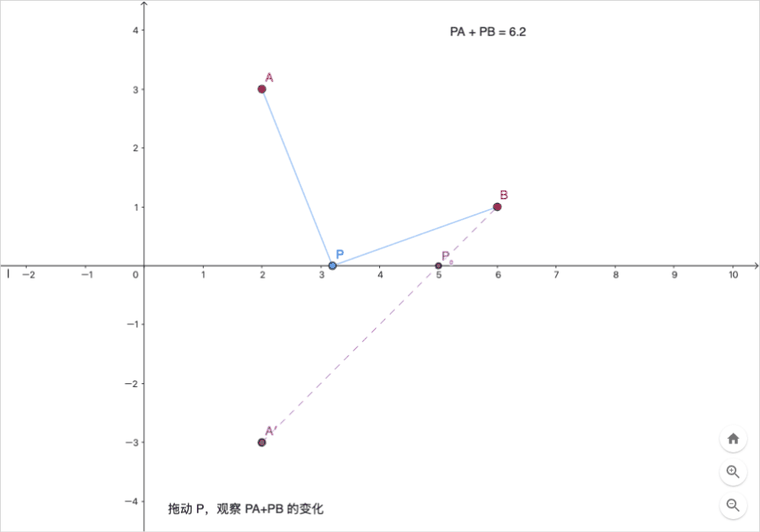
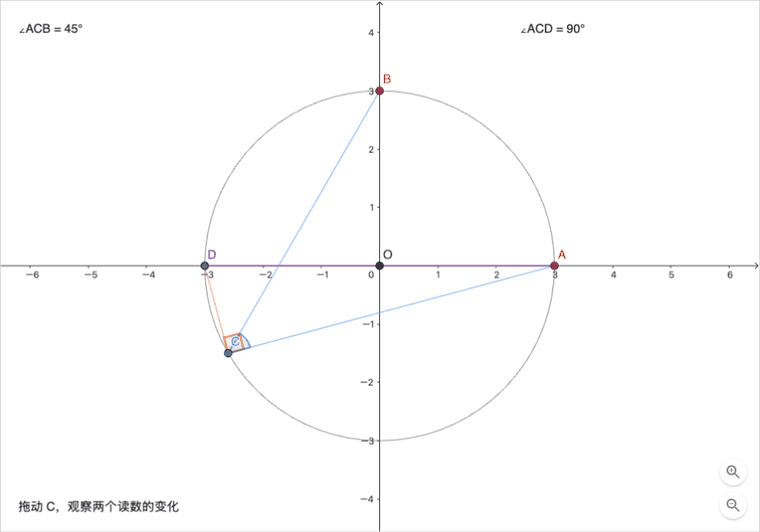
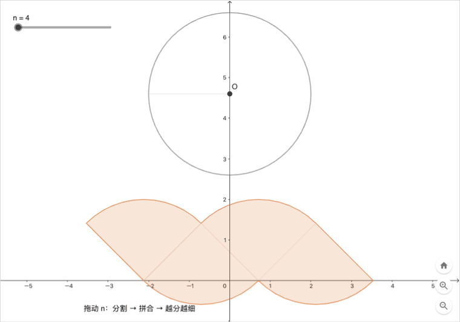

# 我让 AI 一句话画出「能拖的」几何图形：一个 DSH 插件和三个课堂演示

> 利益相关：我是这个插件的作者。下面三张动图都是插件真实交付的截图，没有后期加工。

先问一句：你上次为了讲清楚「将军饮马」，在黑板上画了几遍？

画图这件小事，在课堂上最费时间：图要准、要能拖、还要能随手改条件。GeoGebra 能解决，但对象、命令、样式一个个调，备课时间就这么没了。

于是我做了个插件，让 AI 直接把图「画出来」：你描述题目，它构造、核验，然后丢给你一个可以拖动的 `.ggb` 文件。

---

## 先说结论

- 在 **DeepSeek Harness（DSH）** 里装一个 GeoGebra 插件，用中文或英文描述题目，就能得到可交互图形；
- 它会**真的执行和核验**：点的位置、依赖关系、样式都过了才交付，画错不会塞给你；
- 它**只做分析与作图，不替你解题**——不给答案，也不给证明。

---

## 先看效果

### 1. 将军饮马：P 在哪，PA + PB 最短？



拖动 P，右上角的 `PA + PB` 会先变小、后变大；到 `P₀` 时取到最小值，恰好等于对称点 `A′` 到 `B` 的距离。

这个动图比讲十遍「对称转化、两点之间线段最短」都直观。

### 2. 圆周角：C 怎么动，角度都不变？



拖动 C，`∠ACB` 始终 45°；再作直径 AD，`∠ACD` 始终 90°。

学生自己拖两下，比背定理印象深。

### 3. 圆的面积：为什么是 πr²？



拖动滑块 n，圆被切成 n 份再拼起来。n 越大，拼出的图形越接近长方形：长接近圆周长的一半 `πr`，宽接近半径 `r`，于是面积约等于 `πr × r = πr²`。

「分割 → 拼合 → 越分越细」，这是动态几何最擅长的事。

---

## 怎么装：三步

### 第 1 步：装 DeepSeek Harness

- **桌面版（推荐）**：打开官方站点 <https://www.deepseek.com/harness/> 下载安装包，装完直接打开；
- **命令行版**：需要 Node.js 22+，运行 `npx @deepseek-ai/dsh web`，浏览器会打开 `http://127.0.0.1:3080`。

DSH 还在 developer preview 阶段，更新比较频繁，遇到问题先看仓库 README：
<https://github.com/deepseek-ai/deepseek-harness>

### 第 2 步：申请一个 DeepSeek API Key

1. 打开 <https://platform.deepseek.com> 注册登录；
2. 进 **API Keys** 页面 <https://platform.deepseek.com/api_keys>，点「创建 API Key」；
3. 复制 `sk-...`（只显示一次），填进 DSH 的模型设置里。

Key 只存本机，别发群里；计费和额度以平台页面为准。

### 第 3 步：安装 GeoGebra 插件

插件叫 `ggb-plugins-dsh`，已经发布到 npm（当前 0.8.5）。两种装法：

**A. 让 DSH 自己装（最省事）**

把这句话粘进对话框：

```text
请安装 npm 包 ggb-plugins-dsh@0.8.5 到 desktop profile，运行安装副本里的
setup-plugin，然后提醒我重启 DSH。
```

**B. 命令行**

```sh
dsh plugin --profile desktop add ggb-plugins-dsh@0.8.5
node ~/.dsh/profiles/desktop/node_modules/ggb-plugins-dsh/scripts/setup-plugin.mjs
```

装完**重启 DSH**。首次会下载固定版本的 GeoGebra 运行时（约 32 MB），之后升级只换版本号。

> 桌面版用 `desktop` profile；用 `npx` 启动的 Web 版把命令里的 `desktop` 换成 `web`。

---

## 用起来是什么体验

你可以直接把题目发过去，比如：

```text
将军饮马：直线 l 同侧有定点 A、B，在 l 上找一点 P，使 PA + PB 最短。
```

```text
作圆心为 O 的圆，在圆上取定点 A、B 和可拖动的点 C，显示 ∠ACB 的度数；
再过 A 作直径 AD，显示 ∠ACD 的度数。
```

```text
把圆平均分成 n 份，再拼成一个近似的长方形，用可拖动的 n 展示
「分割 → 拼合 → 越分越细」的过程，帮助理解圆的面积公式。
```

它会先核对条件，再生成构造、跑一遍核验，最后交付：

```
<输出目录>/<题目名>/delivery/
├── <题目名>.ggb        ← 可以直接用 GeoGebra 打开、拖动
├── preview.png         ← 预览截图
├── verification.json   ← 核验报告
└── manifest.json       ← 交付清单
```

小细节：预览窗口在页面加载完成后会自动退出，不占后台、不费电；需要重新加载时再预览一次。

---

## 它不做什么

- **不替你解题**：不给待求答案、关系结论或完整证明；
- **不支持三维**：只做平面几何与代数；
- **外部 GGB 的续改有限制**：需要有可声明的基线；
- **不靠截图蒙混**：核验不通过就不交付，失败会保留证据并说明原因。

---

## 常见问题

**Q：没有 Node.js 能用吗？**
用桌面版就行。

**Q：提示缺 pnpm？**
装 pnpm 11（`npm install -g pnpm`）后重试。

**Q：提示找不到浏览器？**
装 Chrome 或 Edge，插件直接复用，不额外下载 Chromium。

**Q：为什么预览窗口打开后后台任务就结束了？**
GeoGebra applet 加载后已在本地运行，不需要常驻服务。

---

## 开源与反馈

- 源码与问题反馈（MIT）：<https://github.com/Jack7510/ggb-plugins>
- npm：<https://www.npmjs.com/package/ggb-plugins-dsh>
- 插件目录（社区维护，非官方）：<https://dsh-plugin.org>

如果这个插件帮你省下了备课时间，点个赞、收个藏；也欢迎在评论区留下你最想「一句话画出来」的那道题——画得出来，我就做成下一期演示。
