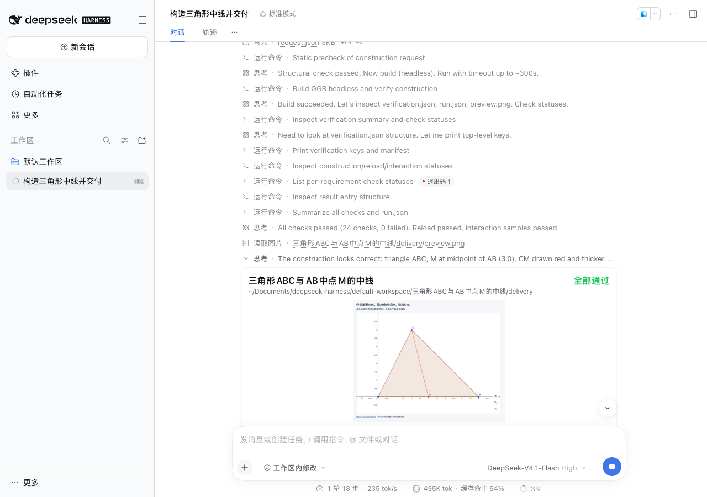

# 0.9.0 本机验证：2026-11-16

## 范围与结论

在本机 macOS、Node 26.5.1、pnpm 11.7.0、DSH 0.2.2-rc.1、Google Chrome 157 上，使用
临时 `DSH_HOME` 和 `web` profile 验证本地构建的 `ggb-plugins-dsh@0.9.0.tgz`。安装、
`setup-plugin`、GeoGebra 5.4.932.1 下载与 SHA-256 校验、doctor、真实会话交付和
交付卡片均通过。

未验证 Desktop profile、Codex/WorkBuddy、失败条件卡片、交互预览按钮点击后的浏览器窗口，
以及 WorkBuddy 客户端装载。

## 安装与就绪

命令按 [DSH 安装说明](../README.md) 执行，使用隔离目录：

```sh
DSH_HOME=<temp> dsh plugin --profile web add <absolute>/ggb-plugins-dsh-0.9.0.tgz
node <temp>/profiles/web/node_modules/ggb-plugins-dsh/scripts/setup-plugin.mjs
```

结果：

- npm/TGZ 安装成功；工具版本 `0.9.0`。
- 官方 GeoGebra 归档 31.9 MB 下载完成，SHA-256 与 `runtime.lock.json` 一致。
- `doctor` 返回 `ok: true`，`smoke`、`casSmoke`、`pathSmoke` 均为 `passed`。
- 使用 Google Chrome 157.0.8103.51。

## 真实会话与交付卡片

在隔离 Web 实例中发送一道三角形中线题，Agent 自主加载 `ggb-construction`，完成
`check`、`build`、交付和 `present`。交付卡片显示：

- 构造 24/24、重载 24/24、交互 38/38，全部通过；
- `preview.png` 缩略图；
- “在浏览器打开交互预览”“打开报告”“打开 GGB”；
- `present` 文件卡列出 GGB、preview.png、verification.json。

浏览器控制台无错误。截图：



## 限制

截图来自 headless Playwright 页面，不代表桌面应用或窄屏/主题矩阵。没有点击交互预览
按钮以避免打开用户浏览器窗口；该命令由单元测试覆盖，真实窗口仍需人工验收。没有构造
失败条件，因此失败原因列表的视觉状态未在本轮验证。临时 `DSH_HOME` 和页面证据不进入
发布包。
